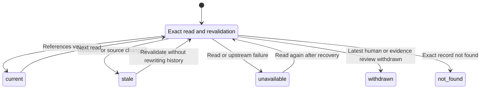

# SEC / Kiwoom ticker verification — 최종 로컬 구조

기준: 2026-10-09 local main `41a7947c6ade9a34521bcdef6ddee2d63fcb4d04`.
Human 전용 연결 수정 `57c7acf30e4df960bf5236a2264d43e7f3f41263` 포함.
이 문서는 현재 코드 계약과 완료된 로컬 검증을 정리한다. 이번 문서 작업에서
DB·외부 원문·운영 배포를 다시 조회하지 않았다. GitHub main / Vercel 상태는 미확인이다.
운영 절차와 검증 범위는 [runbook](../operations/TICKER_VERIFICATION_RUNBOOK.md)을 따른다.

## 목적과 권한 경계

SEC 자동 ticker-resolution 후보 **A**, SEC 원문에 대한 독립적인 human judgment **B**,
Kiwoom 공식 공지·이미지에 대한 evidence review와 수작업 row **C**를 보존하고 비교한다.
이 비교 경로의 review/link/comparison 결과는 모두 `tickerAuthority: none`이다.
B↔C가 일치해도 A를 수정하거나 AUTO로 승격하지 않으며 ticker/current, Watchlist,
Alert에 쓰지 않는다. 기존 SEC 자동 resolution 엔진 자체의 AUTO 판정 계약과는 별개다.

## 데이터 흐름

아래 화살표는 근거·데이터 의존성이다. 모든 단계가 하나의 자동 작업이나 하나의
트랜잭션이라는 뜻은 아니다. Human reading과 Kiwoom 전사는 관리자 작업이다.
원본 전체를 comparison에 복제하지 않고 exact source 참조와 필요한 proof를 연결한다.

```mermaid
flowchart TB
  sec["SEC retained source"]
  raw["canonical raw_items"]
  cover["Exact source + cover observations"]
  a["A&#58; automatic candidate preserved"]
  b["B&#58; independent SEC human reading"]
  kiwoom["Kiwoom official notice and image"]
  c["C&#58; evidence review + manual row"]
  compare["A preserved&#59; B vs C comparison"]
  append["Atomic append&#58; judgment + comparison + audit"]
  reader["Official current-state reader"]
  states["current / stale / unavailable / withdrawn / not_found"]
  sec --> raw
  raw --> cover
  cover --> a
  sec --> b
  kiwoom --> c
  a --> compare
  b --> compare
  c --> compare
  compare --> append
  append --> reader
  reader --> states
```

<!-- mermaid:id=ticker_flow -->

### A / B / C를 섞지 않는 계약

| 자료 | 실제 계약과 검증 |
| --- | --- |
| A | `readSecTickerResolutionByDecisionId`가 재검증한 자동 결과를 원형 보존한다. REVIEW/null/reasons를 human 값으로 덮어쓰지 않는다. |
| B | exact SEC raw source ID/SHA/URL 및 visible text UTF-16 `[start,end)`의 quote proof에 묶인 별도 판단이다. 문자열·좌표 검증은 의미 정확성의 자동 보증이 아니다. |
| C | exact review ID/case/revision, notice, snapshot/image SHA, locator, literal cells를 연결한다. review facts와 수작업 row의 oldTicker/newTicker/effectiveDate가 같아야 한다. |
| B↔C | 세 필드는 `match / conflict / unconfirmed`로 비교한다. 날짜는 occurred 근거와 market-effective 기준이 필요하다. 계좌/결제 날짜를 효력일로 대체하지 않는다. |

[`candidateLink.ts`](../../lib/ticker-verification/kiwoom/candidateLink.ts)의
`createCandidateEvidenceLink`는 기존 strict A↔review 계약을 유지한다.
Human 경로만 `createHumanCandidateEvidenceLink` / `checkHumanCandidateEvidenceLink`를 사용한다.
A의 null 날짜와 C의 명시 날짜 차이는 입력 오류가 아니며,
[`humanException.ts`](../../lib/ticker-verification/kiwoom/humanException.ts)는 A↔B 차이를
`differencesFromAutomatic`에 보존한다. 생성과 current 재검증은 같은 human 계약을 쓴다.

Kiwoom에 없는 CIK·주식 클래스·거래소를 SEC에서 채우지 않는다. SEC-only 거래소 이전은
`exchange.secOnly`에 남고 `kiwoom: null`, `compared: false`다. 같은 심볼·날짜만으로
동일 증권 행을 승인하지 않는다. `rowCorrespondence: unconfirmed`는 `eligible: false`를 유지한다.

## 저장·reader·권한

| 저장소 | 역할 / 코드 근거 |
| --- | --- |
| `raw_items` | 수집 또는 보존 원문의 공통 ingress. Offline import는 기존 source/run/raw 계약을 사용하며 동일 accession의 다른 원문을 덮어쓰지 않는다. [Importer](../../lib/sec-offline-import/) |
| `sec_structured_raw_sources`, `sec_issuers` | cover가 참조하는 exact SEC source의 raw_content/content_hash/source_url 및 issuer 키. 사람의 proof는 이 원문과 exact cover를 재검증한다. |
| `sec_cover_observation_results`, `sec_cover_security_observations` | accession/source SHA/result ID와 증권별 cover 관측. [Persistence](../../lib/sec-cover-observations/persistence.ts), [canonical reader](../../lib/sec-cover-observations/canonical.ts) |
| `sec_ticker_security_identities`, `sec_ticker_change_evidence`, `sec_ticker_resolution_decisions` | 자동 후보의 identity/evidence/evaluation 이력. [Persistence와 exact reader](../../lib/sec-ticker-resolution/persistence.ts) |
| `sec_ticker_resolution_human_decisions` | 기존 SEC identity 승인 도메인. **이 Kiwoom human comparison 경로는 여기에 쓰지 않는다.** |
| `kiwoom_ticker_evidence_reviews` | notice snapshot(이미지 포함), draft/facts/proof, source hash, case/revision/request/actor/audit 연결. [Service](../../lib/ticker-verification/kiwoom/service.ts) |
| `kiwoom_sec_human_judgments` | exact draft와 human judgment/hash, predecessor, 자동 decision/review 연결, server-authenticated actor 및 request/audit 참조. |
| `kiwoom_sec_human_comparisons` | judgment ID에 1:1 대응하는 A/B/C 비교와 comparison hash. 저장 원본과 current-state 해석은 별개다. |
| `admin_audit_logs` | 같은 저장 트랜잭션의 actor role/action/request/case/revision/record hash 기록. |

Human 저장과 공식 조회의 단일 서비스는
[`humanStorage.ts`](../../lib/ticker-verification/kiwoom/humanStorage.ts)다.
[`API`](../../app/api/admin/data/kiwoom-verification/route.ts)는 GET에 `system.read`,
POST에 same-origin 및 `data.run` 검사를 적용한다. Actor는 요청 body가 아니라 인증 세션에서
결정한다. DB RPC도 `private.admin_actor_role`로 operations/super_admin을 확인한다.
순수 comparison 안의 `authentication: not_verified` 및 actor의
`caller_supplied_unverified`는 순수 함수가 인증하지 않는다는 표시다.
실제 API 인증과 audit에 저장된 서버 actor/role을 부정하는 표시가 아니다.

### RPC와 append-only 범위

- `import_sec_offline_archive_raw`: 검증된 offline batch의 source/run/raw 저장. 동일 입력 replay,
  충돌 시 거부. 후속 cover/후보/human 작업까지 묶는 트랜잭션은 아니다.
- `persist_sec_cover_observation_result`: exact source/result/cover rows 저장.
  `record_sec_cover_observation_persistence_state`는 기존 ingest 상태 기록용이며,
  stored-raw replay runner는 raw metadata를 수정하지 않는다.
- `persist_sec_ticker_resolution`: 자동 identity/evidence/decision 저장. 공식 runner는 기존
  issuer lease acquire/renew/release와 exact plan/read-back을 사용한다.
- `admin_record_kiwoom_ticker_evidence`: evidence review + audit 원자적 append.
- `admin_record_kiwoom_human_comparison`: judgment + comparison + audit 원자적 append.
  Request → human case → Kiwoom case 순서의 transaction advisory lock과 revision 검사를 사용한다.
  Judgment/comparison의 상호 deferred FK 및 audit FK가 부분 저장을 방지한다.

Cover와 자동 ticker 이력에는 각각 `reject_sec_cover_observation_mutation`,
`reject_sec_ticker_resolution_mutation` 기반 append-only trigger가 있다.
Kiwoom review의 `kiwoom_evidence_append_only`, judgment의 `kiwoom_human_append_only`,
comparison의 `kiwoom_comparison_append_only` trigger는 모두
`private.kiwoom_evidence_append_only()`로 UPDATE/DELETE를 거부한다.
Audit는 service_role SELECT/INSERT 권한 경계로 보호된다. Kiwoom 전용 trigger가
모든 기존 테이블이나 DB 소유자의 모든 권한까지 제한한다고 해석하지 않는다.

Review/judgment/comparison 테이블은 RLS를 켜고 public/anon/authenticated 직접 접근을
철회한다. service_role은 SELECT/INSERT만 허용하고 저장 RPC 실행 권한을 가진다.
이는 서버 경계이며 브라우저에 service key나 직접 SQL/RPC 쓰기 권한을 제공하지 않는다.

### Replay와 revision

동일 actor + request ID + exact body/hash는 저장 결과 `replayed`를 반환한다.
`saveHumanComparison`의 빠른 replay는 외부 source fetch 및 저장 RPC 없이 기존 결과를 읽는다.
경쟁 상황에서도 RPC의 unique/lock/hash 검사가 중복 append를 막는다. 같은 request ID에 다른
body는 `KIWOOM_HUMAN_IDEMPOTENCY_CONFLICT`다. Replay 응답은 **과거 저장의 재조회**이며 current 보증이 아니다.

새 revision은 같은 case, 최신 `expectedRevision`/`previousId`, predecessor judgment SHA를
검사한 뒤 append한다. 과거 행은 그대로 남는다. Withdrawal은 같은 case의 새 revision이며,
기존 대상/값/proof를 바꾸지 않고 status/reason으로 철회한다. 철회된 human case에 다시 append하여
복원하는 경로는 없다. 철회는 실제 증권의 ticker 변경을 취소하는 동작도 아니다.

## Current-state reader

아래는 저장 행을 변경하는 state machine이 아니라 **조회 시 파생하는 상태**다.
`read`는 설명용 분기점이며 API status가 아니다. current-state GET은 latest revision,
후보/source/review/proof를 확인하고 필요한 경우 현재 Kiwoom 원문을 다시 가져온다.

<!-- mermaid:id=ticker_states -->

| Status | 의미 / 오해하면 안 되는 점 |
| --- | --- |
| `current` | 현재 참조와 저장 comparison의 재검증이 통과했다. 의미 정확성, eligible, 동일증권 승인, ticker 승인이 아니다. |
| `stale` | 과거 human revision(`human_revision_changed`), 변경된 source 또는 참조 불일치. 과거 기록을 삭제하지 않으며 변경된 publisher 원문을 예전 snapshot으로 대체하지 않는다. |
| `unavailable` | upstream 장애, DB/reader 실패 또는 검증 불가능. 데이터 부재나 의미 충돌이라는 결론이 아니다. |
| `withdrawn` | 최신 human judgment 또는 참조 evidence review가 철회됨. 최신 human 철회는 과거 revision을 읽을 때도 우선 반영된다. |
| `not_found` | exact judgment 또는 필요한 참조가 not-found로 확인됨. 권한/조회 장애를 이 상태로 바꾸지 않는다. |

최신 human 철회 → 과거 revision 여부 → 현재 source 재검증 순으로 조기 반환할 수 있다.
따라서 모든 GET이 외부 원문 fetch를 수행한다고 가정하지 않는다. HTTP 200과 `data.status`도
별개다. 원문이 같아져 current로 돌아오는 조회가 있어도 저장 history를 수정한 것은 아니다.

## 개발 원칙과 적용 경계

| 원칙 | 현재 구현 |
| --- | --- |
| Single Source of Truth | 원문은 exact retained source, 자동값은 official candidate reader, human은 별도 judgment. 어느 하나를 다른 자료의 정답으로 복사하지 않는다. |
| Provenance | SEC source ID/SHA/URL/UTF-16 quote 및 Kiwoom snapshot/image/locator/review revision을 연결한다. |
| Immutability / Append-only | 위 trigger와 predecessor hash로 기존 review/judgment/comparison을 보존한다. 수정 의미는 새 revision에 기록한다. |
| Idempotency | actor/request unique, exact draft/hash, replay/collision 검사. 재요청이 새 revision을 만들지 않는다. |
| Atomicity | 각 저장 RPC의 명시된 행 집합만 한 트랜잭션. 원문 수집부터 모든 작업을 하나의 transaction으로 표현하지 않는다. |
| Exact identity binding | `candidateLink`와 `humanStorage`가 exact decision/revision/source/review/row를 묶는다. 회사명·CIK만으로 동일 증권을 승인하지 않는다. |
| Fail closed | 누락·stale·장애·class 충돌·미확정 row를 권한으로 승격하지 않는다. |
| Command–Query Separation | preview/current/history는 이 도메인의 저장 RPC를 실행하지 않는다. 저장은 명시적 POST이며 인증 시스템의 session refresh와는 별도 범위다. |
| Least authority | same-origin/admin 권한 + service-role RPC 경계. 모든 supporting comparison 결과의 tickerAuthority는 none. |

## PSKY → SKYD 로컬 검증 사례

| 자료 | old → new | effectiveDate | class / 상태 |
| --- | --- | --- | --- |
| Automatic A | PSKY → SKYD | null | B / REVIEW; `EXCHANGE_CONFLICT`, `SUPPORTED_CHANGE_EVIDENCE_MISSING` 유지 |
| SEC human B | PSKY → SKYD | 2026-10-06 | B / occurred |
| Kiwoom C | PSKY → SKYD | 2026-10-06 | 미기재; SEC class를 복사하지 않음 |

B↔C oldTicker/newTicker/effectiveDate는 match. A↔B 날짜 차이 null → 2026-10-06은 보존한다.
SEC proof는 visible text UTF-16 `[3086,3361)`이며, Nasdaq → NYSE는 SEC-only/compared=false다.
`rowCorrespondence: unconfirmed`, `assessment.eligible: false`, `tickerAuthority: none`이다.
Human revision 2의 current 판정이 A의 REVIEW/date null을 바꾸지 않았다.

최종 검증 상태와 과거 단계별 문서는 [runbook의 검증 기록](../operations/TICKER_VERIFICATION_RUNBOOK.md#현재-검증-상태)에 모았다.
