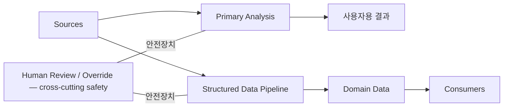

# 00 Service Model

> **SERVICE MODEL — 합의한 상위 개념이며 현재 구현 검증 결과가 아니다.**
> 아래 분류와 개념도는 실제 파일·테이블·provider·production 실행 연결을 주장하지 않는다. 실제 연결은 `UNKNOWN / TO AUDIT`이다. [No inference 및 상태 규칙](README.md)을 따른다.

## 네 서비스 축

| 서비스 축 | 개념적 책임과 범위 |
| --- | --- |
| **Primary Analysis** | SEC 공시와 뉴스의 투자자용 분석. Feed, Filing Detail, score-based Alert 및 사용자에게 제공하는 분석 결과. validation, repair, re-analysis는 이 내부 처리이며 별도 “2차 분석”이 아님 |
| **Structured Data Pipeline** | Stock Detail과 Monitor 등에서 재사용할 구조화 데이터를 만드는 축. XML/XBRL parser, deterministic extraction, 필요한 structured LLM analysis, GPT/Human-assisted 관리, Human Review/Override 등 여러 방식이 있을 수 있음. 모든 방식이 실제 연결됐거나 필수라는 뜻은 아님 |
| **Domain Data** | 업무별 데이터 구분. 현재 합의한 예시는 Ownership, Financials, Dilution, Listing / Delisting / Identity, Corporate Actions. 다른 도메인이나 이들 사이의 경계는 여기서 추가 확정하지 않음 |
| **Consumers** | Stock Detail, Monitor, Matcher, Monitor Alert, API/UI 등의 소비·평가·표시 관점. 실제 읽는 데이터와 호출 관계는 UNKNOWN |

이는 물리적으로 분리된 네 서비스나 일렬의 네 처리 단계라는 뜻이 아니다. Primary Analysis는 서비스 책임을, API/UI 등의 Consumers는 소비 역할을 표현할 수 있다. 같은 화면의 역할을 여러 관점에서 설명한다고 별도 구현이 존재하는 것으로 세지 않는다.

**Canonical Data Pipeline 대신 Structured Data Pipeline을 상위 명칭으로 사용한다.** 기존 코드·DB의 `canonical` 이름을 바꾸거나 그 이름만으로 데이터 품질과 소비 권위를 보증하지 않는다.

## SERVICE MODEL 개념도

다음 한 개의 도식은 의도한 서비스 모델만 표현한다. 화살표는 개념적 정보 흐름이며 검증된 호출·저장·운영 순서가 아니다. Human Review/Override와 연결된 **화살촉 없는 선**은 cross-cutting safety mechanism의 개념적 관여를 뜻한다. 모든 데이터가 사람 승인을 거친다거나 특정 단계에서 항상 호출된다는 뜻은 아니다.

Sources의 실제 구성과 각 연결의 구현 여부는 UNKNOWN이다. 사용자용 결과는 투자자에게 제공하는 분석·표시·Score Alert를 개념적으로 묶은 것이다. Human Review/Override는 독립적인 필수 분석 단계로 세지 않는다.

## 용어집 — 문서에서 사용할 의미

| 용어 | 확정한 문서 의미 |
| --- | --- |
| **Source Evidence** | 원본 근거 |
| **Extracted Fact** | parser/LLM 등이 추출했지만 최종 신뢰값이라고 아직 단정하지 않는 값 |
| **Canonical Fact** | 출처·품질 조건을 충족해 재사용 가능한 구조화 값. 구체적인 조건과 해당 값의 충족 여부는 실제 근거로 확인 |
| **Effective Value** | 자동판정과 Human decision/override 등을 고려해 consumer가 현재 실제로 읽는 최종값. 실제 reader/consumer 연결이 확인돼야 구현 사실로 기록 가능 |
| **Projection** | 과거 원본을 바꾸지 않고 현재 관점으로 계산한 값 |
| **Primary Repair** | Primary Analysis 내부의 validation/repair. 별도 Structured Analysis와 구분 |
| **Structured Analysis** | Structured Data Pipeline에서 구조화를 위해 수행하는 LLM 분석 |
| **Score Alert** | Primary Analysis score 기반 Alert |
| **Monitor Alert** | 사용자 Monitor 조건/Matcher 기반 Alert |

이 용어집은 논리적 의미를 정한다. 실제 코드의 타입·함수·테이블에 대한 일대일 매핑은 아직 UNKNOWN이다. Source Evidence, Extracted Fact, Canonical Fact, Effective Value, Projection을 모두 거쳐야 하는 고정 순서나 서로 다른 저장소가 있다고 가정하지 않는다.

Human Review는 검토 목적을 구분해 조사한다. 예를 들어 Identity Review와 Analysis Review라는 역할을 동일한 판단으로 묶지 않으며, 이 단계에서 실제 구현·저장·소비 연결을 확정하지 않는다.

## VERIFIED AS-IS와의 경계

이 파일에는 기능 구조의 VERIFIED AS-IS 항목이 없다. Primary와 Structured 사이의 실제 공유·독립 여부, 도메인별 데이터 생성 방식, consumer의 effective 값 사용 여부, 자동 실행 여부는 모두 `UNKNOWN / TO AUDIT`이다.

이 모델을 구현하기 위한 코드 재배치나 새로운 시스템을 제안하는 것도 아니다. `PROPOSED` 구현 변경은 현재 없다.
