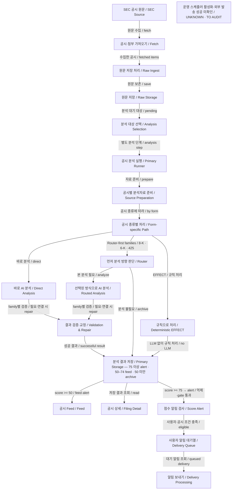

# SEC Primary Analysis — VERIFIED AS-IS

> **No inference.** 이 문서는 SERVICE MODEL이 아니라 Architecture Map 3단계-A 감사에서 확인한 현재 구조의 기록이다. 확인하지 못한 실행·연결은 `UNKNOWN / TO AUDIT`로 남긴다.

- 기준 코드 commit: `8cb52893a84c8de73051ae2b87427a054b9897cf` (`main`).
- 근거: 앞선 감사의 현재 코드 호출 추적과 shared-local 기존 SEC 공시 3건의 읽기 전용 DB 대조.
- 이번 3단계-A2는 그 결과의 문서화만 수행한다. 새 코드·DB 조사, ingest, LLM, 제품 실행은 하지 않았다.
- **새 Product E2E를 수행하지 않았다. 이 문서에는 E2E VERIFIED 항목이 없다.** 저장된 과거 실행 결과를 현재 commit의 제품 E2E로 승격하지 않는다.

| 상태 | 의미 |
| --- | --- |
| `VERIFIED CODE` | 코드에서 실제 분기·호출·저장 또는 소비 계약을 확인. production 활성화나 실행 성공을 뜻하지 않음 |
| `VERIFIED STORAGE` | 기존 DB 표본의 실제 row·연결·값을 대조. 적용 범위는 해당 표본뿐 |
| `UNKNOWN / TO AUDIT` | 실행 여부, 범위 또는 근거를 확인하지 못함. 부재나 실패로 단정하지 않음 |

## 1. 쉬운 설명

SEC Primary Analysis는 공시를 가져와 투자자가 읽을 수 있는 설명과 점수로 만드는 처리다. **공시 수집·raw 저장과 Primary 분석은 별도 단계**다. Workflow는 저장된 공시 중 분석할 대상을 골라 공통 Primary runner를 호출한다. raw ingest API 자체가 항상 분석까지 수행하는 구조는 아니다.

공통 runner 안에서도 공시 종류에 따라 방식이 다르다. 준비한 자료를 바로 LLM으로 분석하는 종류, 먼저 router가 처리 방향을 정하는 종류, LLM 없이 결정적으로 처리하는 EFFECT 경로가 있다. 사용자에게 보여줄 현재 분석 결과와 AI 실행·출력 이력은 별도 저장한다. Feed와 Filing Detail은 저장 결과를 읽고, **Score Alert는 분석 점수 기반의 별도 알림 평가**를 수행한다. 사용자 조건을 평가하는 Monitor Alert와는 다른 시스템이다.

자동 연결 코드는 확인했지만, 실제 배포 환경에서 SEC 수집 scheduler가 활성화돼 있는지는 이번 감사에서 확인하지 않았다.

## 2. SEC Primary As-Is 도식

아래 노드·화살표는 모두 `VERIFIED CODE` 수준이다. DB 확인은 9절의 세 표본에만 별도로 부여한다. `Primary runner → source preparation → family`는 runner 내부 처리를 펼친 것이다. Fetch에서 Raw Ingest로 향하는 선은 가져온 데이터의 전달이며, 실제 fetch 호출자는 Raw Ingest다.

**그림 읽는 법**

- 박스는 처리 단계, 화살표 라벨은 실제 확인된 주요 분기조건이다.
- 한국어는 빠른 이해를 위한 설명, 영어는 코드·개발 용어 대응이다. 세부 조건은 본문 표와 근거를 참조한다.
- 검증 단계의 `repair`는 해당 family에 교정 호출이 연결되고 교정이 필요한 경우만 뜻한다. diagnostic-only family도 같은 검증 박스로 요약했으며, 모든 공시에 repair LLM이 실행되는 것은 아니다.
- 점수는 저장 등급 기준이다. `<50 → archive`는 Feed 제외를 뜻하며, `score >=75 → alert`도 사용자 자격·억제·identity/analysis gate를 통과해야 큐로 이어진다. 외부 발송 성공을 뜻하지 않는다.
- 운영 scheduler 활성화·실제 외부 발송과 미검증 family 실행은 `UNKNOWN / TO AUDIT`로 유지한다.

### 도식의 해석 한계

- Raw Storage 다음의 Workflow analysis selection은 raw 저장 함수의 직접 분석 호출을 뜻하지 않는다. Workflow가 raw ingest step 이후 pending raw를 선택해 별도 analysis step을 호출한다.
- `Validation / Repair where wired`는 모든 family가 repair LLM을 호출한다는 뜻이 아니다. diagnostic-only와 조건부 repair를 5절에서 구분한다. EFFECT는 이 LLM repair 경로를 통과하는 것으로 그리지 않았다.
- Router의 archive 분기에서는 본 분석을 생략할 수 있다. router LLM까지 실행하지 않는다는 뜻은 아니다. 다른 skip·실패·dry-run 분기는 이 개요도에서 생략했다.
- Primary Storage는 사용자용 저장과 AI trace 저장의 묶음이다. 단일 테이블·원자적 트랜잭션·모든 실패의 trace 보존을 뜻하지 않는다.
- Score Alert는 조건에 맞고 억제되지 않은 결과만 평가한다. 큐에서 scheduler로 향하는 선은 scheduler가 큐를 읽는 코드 연결이다. 즉시 전송이나 실제 Telegram/email 발송 성공을 뜻하지 않는다.
- Monitor Alert는 별도 시스템이며 내부 구조를 이 그림에 포함하지 않는다.

### 큰 연결의 코드 근거

아래 경로와 행 번호는 기준 commit에 대한 앞선 감사 기록이다.

| 연결·역할 | 직접 확인한 코드 근거 | 상태 |
| --- | --- | --- |
| SEC Source → Fetch | `lib/sources/sec/parser.ts:154` `fetchSecEdgarRawItems`; current feed `:492`, accession lookup `:523`, filing detail `:796` | VERIFIED CODE |
| Fetch → Raw Ingest → Raw Storage | `lib/secIngest.ts:64` `runSecRawIngest`; `lib/secStores/rawStore.ts:32` `saveSecRawItem`, raw upsert `:58` | VERIFIED CODE |
| Raw Storage → pending selection → Primary | `workflows/source-ingest.ts:78` `secSourceIngestWorkflow`, analysis step `:470`, Primary 호출 `:499`, pending 선택 `:658` | VERIFIED CODE |
| Primary runner → preparation/family | `lib/secFilingAnalysisIngest.ts:51,71`; 실제 공통 runner `lib/ai/secFilingAnalysisPreview.ts:744`; package `lib/prompts/secFilingAnalysisPackage.ts:57`; worker `lib/sources/sec/forms/formWorkerRegistry.ts:221` | VERIFIED CODE |
| 성공 분석 → 사용자용 저장·AI trace | `lib/secFilingAnalysisIngest.ts:195–229`; `lib/secStores/eventStore.ts:60,1005` | VERIFIED CODE |
| 저장 → Feed / Detail | `lib/liveFeed.ts:209`; `lib/liveFeedV2.ts:59`; `app/filings/[id]/page.tsx:4692` | VERIFIED CODE |
| 저장 → Score Alert 평가 → 사용자 큐 | `lib/secFilingAnalysisIngest.ts:434`; `lib/alerts/delivery/runAlertDeliveryForEvent.ts:9`; `evaluateAlertDelivery.ts:88`; `createUserAlertDelivery.ts:9` | VERIFIED CODE |
| 큐 → delivery scheduler | `lib/alerts/delivery/runAlertDeliveryScheduler.ts` → `processQueuedDeliveries.ts`; `app/api/cron/alert-delivery/route.ts` | VERIFIED CODE |

### 자동·수동 경로 구분

`secSourceIngestWorkflow`에는 raw ingest와 pending 분석을 이어주는 호출이 있다. 기존 완료 event와 workflow 상태를 확인해 분석 재실행을 건너뛰는 분기도 있다. 반면 `app/api/sources/sec/ingest/route.ts`와 raw ingest CLI는 raw 단계만 호출한다. 별도 `app/api/sources/sec/analyze/route.ts`가 Primary runner로 연결된다. 수동/debug/replay 실행을 자동 운영 실행과 동일시하지 않는다.

`app/api/cron/source-ingest/[lane]/route.ts`에는 인증·enabled lane 확인 후 Workflow를 시작하는 코드가 있다. 감사한 `vercel.json`에는 market-cache와 alert-delivery cron은 있으나 SEC source-ingest cron은 없었다. **외부 scheduler·배포 환경의 활성 설정은 UNKNOWN**이다. 설정 파일 하나만으로 외부 자동 실행이 없다고 단정하지 않는다.

## 3. Family Differences

이 표는 모두 `VERIFIED CODE`다. 모든 family의 실제 저장 표본이나 실행을 검증한 표가 아니다. 분기 위치는 별도 표기가 없으면 `lib/ai/secFilingAnalysisPreview.ts` 기준이다.

| Form family | 공통 runner에서 확인한 실제 차이 | 경계·근거 |
| --- | --- | --- |
| Form 4 / 144 및 정정본 | Ownership parser/source blocks를 이용한 direct analysis. router LLM 없음 | `:957`; `secOwnershipAnalysisAdapter.ts:55`. Primary 실패에도 parser-only 상세 저장으로 이어질 수 있으나 Primary 성공과 다름 |
| 8-K / 6-K | Router → analysis 또는 archive | `:1306`. archive도 router LLM을 거친 분기 |
| 425 | Router → analysis 또는 archive, 별도 model plan/조건부 repair | `:1081`. router·응답 재시도와 semantic repair를 구분 |
| S-1 / F-1 | 실제 공통 runner에서는 direct analysis | `:2101`. 별도 route-only preview 함수를 production router로 간주하지 않음 |
| 424B | Direct analysis | `:2028` |
| S-3 / F-3 | 본 분석은 direct. amendment triage 및 skip_analysis 분기 존재 | `:2174`, triage `:880`; skip 결과는 일반 성공 event 저장과 다를 수 있음 |
| SC13 | Source-block direct analysis | `:1656`. deterministic result builder는 현재 `null` 반환; helper 존재만으로 parser-only 또는 router 경로라고 하지 않음 |
| S-8 | Direct analysis | `:1904`. deterministic result builder는 현재 `null` 반환. 결정적 분류와 router LLM은 다른 개념 |
| Tender, S-4 / F-4 | Family-specific direct analysis | 각각 `:1532`, `:1780` |
| NT | Family-specific direct analysis | `:2248`; CXJ 저장 표본 대조 |
| Form 25 | Parser/관련 공시 context 기반 direct analysis | `:2402`; T2 Biosystems 저장 표본 대조 |
| Periodic reports | 10-K/Q, 20-F, 40-F 및 지원 정정본의 family-specific direct analysis | `:2559`; Gulf Resources 10-Q 저장 표본 대조 |
| Proxy | Family-specific direct analysis | `:2688` |
| EFFECT | `buildDeterministicEffectAnalysis` → `analyzeEffectFiling`, LLM 없는 결과 생성 | `:787,4449`; 이번 DB 표본으로 실행 확인하지 않음 |
| Form 3 / 5 | 일반 Primary 지원 manifest에 포함되지 않음 | `lib/sources/sec/forms/common/forms.ts:9` Ownership 목록은 4/144. 별도 XML 경로의 존재를 Primary 연결로 확장하지 않음 |
| Generic fallback | 공통 runner에 코드 존재 | `:2815`; 실제 unsupported family의 운영 사용은 UNKNOWN |

## 4. Source Preparation

**VERIFIED CODE:** 모든 SEC 원문을 그대로 LLM에 보내는 하나의 공통 구조가 아니다.

1. Fetch는 filing index에서 primary 문서와 attachment를 고른다. form fetch plan에 따른 document selection이 있다 (`parser.ts:796,848,1072`).
2. Raw에는 `body_text`, `analysis_text`, document inventory와 primary HTML/attachment text 등 `raw_payload`가 저장된다. 이 저장을 모든 family의 원본 바이트 전체 보관으로 일반화하지 않는다.
3. Filing package는 문서 구간, identity, adapter/parser 결과, market·parent context, truncation 정보를 묶는다 (`secFilingAnalysisPackage.ts:57,209`). package 기본 제한은 전체 60,000자·문서당 24,000자지만 이를 모든 family의 최종 prompt 길이로 간주하지 않는다.
4. Form worker/parser 결과에서 source blocks 또는 compact input을 만들고 family별 prompt를 구성한다. Form 4/144는 Ownership source blocks, Form 25는 `cleaned_source_blocks_input`과 관련 공시 context, periodic·NT는 해당 family source blocks를 사용한다. S-3도 compact source-block input을 사용한다.
5. 공통 요청 코드는 준비된 system/user prompt를 provider에 전달한다. 코드에 OpenAI/Gemini 경로가 있지만 현재 production에서 어떤 설정을 사용하는지는 UNKNOWN이다.

대표 근거: `secOwnershipAnalysisAdapter.ts:55`, `forms/form25/analysisPrompt.ts:309`, `secPeriodicReportsAnalysisAdapter.ts:63`, `forms/nt/analysisPrompt.ts:150`, `lib/prompts/secS3OfferingAnalysis.ts:309`. 앞의 `forms/*`, adapter 경로는 `lib/sources/sec/`, `lib/ai/` 하위다.

LLM 직전의 전체 최초 입력 객체·system/user prompt·router output이 모든 family에서 DB에 그대로 남는다는 증거는 없다. Repair prompt/선택 근거가 trace에 남는 경우와 구분한다.

## 5. Validation / Repair

아래는 `VERIFIED CODE`다. **공시당 최대 N회**라는 하나의 숫자로 합치지 않는다.

| 종류 | 확인된 동작·한계 | 코드 근거 |
| --- | --- | --- |
| Transport / 응답·JSON 재시도 | 공통 요청 최대 시도 설정은 3. provider·요청 옵션에 따라 다른 실행 계획 사용 | `secFilingAnalysisPreview.ts:308,3457`. Gemini 경로의 primary/primary/fallback 순서는 `:4629` |
| Semantic diagnostic-only | 8-K/6-K, S-1/F-1, S-3/F-3, 424B는 분석 결과와 diagnostics를 반환. 이 경로의 semantic 오류가 곧 repair LLM 호출을 뜻하지 않음 | `lib/ai/secPrimaryValidationDisposition.ts:115` 및 각 실제 runner 분기 |
| 조건부 semantic repair | Ownership, SC13, S-8, Tender, S-4/F-4, NT, Form 25, Periodic, Proxy와 425의 repair plan 분기. plan이 있을 때 허용 필드 patch·적용/무시 내역을 추적 | 해당 family runner의 repair 호출은 `maxAttempts:1`, `disableFallback:true`. 모든 성공 결과에 repair가 필요한 것은 아님 |
| Router-specific / 응답 특수 재시도 | 8-K/6-K router 저품질 응답의 추가 시도, 425 runaway 응답의 별도 추가 시도 | `secFilingAnalysisPreview.ts:3403,3464–3482`; 일반 semantic repair와 별개 |
| Workflow retry | raw/analysis step의 `maxRetries=3`; 이미 완료된 분석을 피하는 disposition/pending 선택과 함께 사용 | `workflows/source-ingest.ts:440,548,658` |

EFFECT의 deterministic 경로를 LLM repair 대상으로 표시하지 않는다. Validation은 오류를 보고하는 역할이며, repair LLM의 출력과 적용 trace를 자동 숫자 보충 로직으로 설명하지 않는다.

`lib/secValidationRepairTrace.ts:17`은 최초 parsed/text, repair parsed/text·prompt, 최종 결과, 적용 전후 값, 무시한 patch, unresolved·usage 등을 담는다. Gulf Resources 표본에서는 repair 성공과 적용 변화 5건을 실제 확인했다. 반대로 **모든 분석 실패에 AI trace가 남는 것은 아니다**. ingest 실패 저장 분기는 repair 시도 여부 또는 Ownership 실패 등에 조건부이며, 입력 준비 이전 예외까지 보편적으로 보존된다고 할 수 없다 (`secFilingAnalysisIngest.ts:76–129`).

## 6. Storage

계약은 `VERIFIED CODE`; 실제 row 대조는 9절의 범위만 `VERIFIED STORAGE`다.

| 저장 | 역할 | 확인된 consumer / 제한 |
| --- | --- | --- |
| `source_runs` | raw 수집 실행 상태와 metadata | Raw ingest 실행 기록. Primary AI 실행 이력과 별개 |
| `raw_items` | accession 기반 source 식별, 공시 텍스트·선택 문서·raw payload·workflow metadata | Primary 입력, 재분석, 원문/debug 조회. raw 저장만으로 분석 완료를 뜻하지 않음 |
| `events` | 사용자용 현재 분석의 제목·요약·점수·delivery level·당시 ticker·display payload 등 | Feed, Filing Detail, Score Alert 평가 |
| `event_analysis` | why_it_matters, bullish/bearish, key_evidence, watch_next 등 설명 | Feed 상세 자료 및 Filing Detail |
| `ai_runs` | prompt/version/model/status/usage/error 및 raw/event 연결 | AI 실행·debug·일부 review 경로 |
| `ai_outputs` | 분석 JSON, output text, usage/cost, validation/repair trace | 실행 결과·근거 추적. 현재 사용자 표시용 event와 분리 |
| `event_tickers` | event와 관련 ticker 연결 | Feed/Detail 및 Alert event 정규화. 저장 시 연결을 교체하는 코드가 있음 |
| Offering terms / event calendar 관련 저장 | 해당 분석의 조건부 파생 저장 연결 | event 저장 함수에서 호출을 확인한 범위만 기록. 도메인 reader 내부·전체 consumer는 이번 감사 밖 |
| `user_alert_deliveries` | Score Alert 평가 후 적격 user/event의 전달 큐·이력 | delivery scheduler. 세 표본의 해당 row는 0건 |

주요 근거: `lib/secStores/rawStore.ts:32,81,98`; `eventStore.ts:60,217,237,455,480,790,1005,1057,1094`; `lib/alerts/delivery/createUserAlertDelivery.ts:9`.

일반 분석 저장은 기존 event ID를 찾아 `events` 및 `event_analysis`의 현재 결과를 upsert할 수 있다. AI trace 저장은 새 `ai_run`과 `ai_output` ID를 만든다. 따라서 **현재 표시 결과 갱신**과 **새 AI 실행 기록 추가**는 구분한다.

SC13/Ownership XML, cover observation, ticker resolution, Form 25 identity/상폐 판정, 도메인 facts·Monitor hook 등의 호출도 발견됐지만, 여기서는 연결 존재만 기록한다. Structured Data Pipeline·Monitor 내부 구조나 해당 저장의 완전성을 이번 문서에 추가하지 않는다.

## 7. Re-analysis / Debug Warning

모두 `VERIFIED CODE`이며 이번에 실행하지 않았다.

| 경로 | 다시 호출하는 것 | 보존·갱신 차이 |
| --- | --- | --- |
| 일반 분석 재실행 | `/api/sources/sec/analyze` → `runSecFilingAnalysisIngest` → 공통 runner | force/기존 상태에 따른 재실행. 정상 저장 시 새 AI trace를 추가하지만 현재 `events`/`event_analysis`는 upsert 가능 |
| Form 25 Admin retry | Admin action → `retryForm25Analysis` → 공통 runner | retry claim/completion을 decision 이력에 남기고 새 AI trace 저장. 일반 event 저장 함수는 호출하지 않는 별도 경로 |
| SEC debug controlled persist | 공통 ingest 분석 runner, `force:true`, `suppressAlerts:true` | 선택적 reset 이후 실행할 수 있음. 일반 분석과 옵션·실행 목적이 다름 |
| SEC debug reset | `runSecDevResetAnalysis` 및 reset helper | 해당 범위의 delivery·calendar 연결·event ticker·offering terms·event analysis·AI outputs/runs·events 삭제 코드가 있음. raw는 보존 |

근거: `lib/sec-form25-analysis-review/persistence.ts:74`; `app/api/admin/data/form25-analysis/[rawItemId]/route.ts`; `lib/development/secFormDevDashboard.ts:1853,1916,1923,2061,2252`.

**“모든 재분석은 append-only” 또는 “debug 재실행은 항상 과거 결과를 보존한다”라고 일반화하지 않는다.** Form 25 Human correction은 별도 effective overlay이며 원래 AI 기사와 같은 저장값으로 취급하지 않는다. 이 Form 25 경로를 모든 family의 공통 Human Review라고 확대하지 않는다.

## 8. Consumers

### Feed — VERIFIED CODE

`/api/feed-v2` → `loadLiveFeedV2Page` / Live Feed view model → `events` 조회로 연결된다. archive delivery level은 제외한다. 필요할 때 `event_analysis`, raw metadata, `event_tickers`를 읽고 Form 25 identity/review overlay를 적용한다.

근거: `app/api/feed-v2/route.ts`, `lib/liveFeedV2.ts:59`, `lib/liveFeed.ts:209,225,517,533`, `lib/supabase.ts:84`.

### Filing Detail — VERIFIED CODE

Filings 목록은 `search_filings_v2` RPC를 사용한다. 상세는 event ID로 `events`, `event_analysis`, `event_tickers`, raw source와 Form 25 effective identity/review를 읽는다. `metadata.display_payload`와 설명 저장값을 family별 화면에 사용한다. 이번 단계에서 실제 화면을 새로 열어 표시를 대조하지는 않았다.

근거: `lib/filingsV2Data.ts:133`, `app/filings/[id]/page.tsx:4692–4701`, `readStoredFilingSourceContent` 호출.

### Score Alert — VERIFIED CODE

event 저장의 점수 구간은 75 이상 `alert`, 50 이상 `feed`, 나머지 `archive`다 (`eventStore.ts:1654`). alert 등급이라고 모든 사용자에게 즉시 보내지는 않는다.

1. `enqueueSecFilingAlertCandidate`는 별도 큐 row를 넣는 함수가 아니다. `events.delivery_level` 기반 후보 여부를 반환한다 (`lib/secStores/alertQueue.ts:28`).
2. 분석 ingest는 억제되지 않은 alert 등급에 대해 `runAlertDeliveryForEvent`를 호출한다. batch 경로도 저장된 alert event를 선택한다.
3. 저장 event를 정규화한 뒤 사용자 plan/preferences, 종목별 구독, discovery category, channel 등의 조건을 평가한다. Form 25 effective identity/analysis gate도 통과해야 한다.
4. 적격 대상은 `user_alert_deliveries`에 user/event dedupe를 적용해 저장한다. Scheduler가 queued delivery를 읽고 전송 직전 조건을 재확인한다.
5. 실제 사용되는 `processQueuedDeliveries.ts`에는 web 처리·Telegram·email 전송 호출이 있다. 자격증명·환경 flag·production 활성화·외부 발송 성공은 UNKNOWN이다.

Form 25 Human correction 표시와 Score Alert 사용 가능 여부는 동일하지 않다. `lib/sec-form25-analysis-review/consumer.ts`의 Score Alert gate는 ORIGINAL/available 등 별도 조건을 확인한다. UI에서 correction이 보인다는 이유로 자동 발송까지 허용됐다고 하지 않는다.

**Monitor Alert는 별도 시스템이다.** 일반 사용자 조건 Matcher나 Monitor Alert의 내부 구조를 Score Alert 도식·계약에 포함하지 않는다. 구독/plan을 읽는 코드가 있다는 사실로 결제부터 전달까지 검증됐다고 하지 않는다.

## 9. Verification Evidence

### 코드 기준

Verified commit은 `8cb52893a84c8de73051ae2b87427a054b9897cf`다. 이 문서의 코드 근거는 앞선 3단계-A 감사에서 확인한 호출 위치를 사용했다. 이번 문서 작성 중 새 코드 조사는 하지 않았다.

### 기존 shared-local 저장 표본 — VERIFIED STORAGE

앞선 감사에서 `BEGIN READ ONLY` / `ROLLBACK`으로 실제 row를 대조했다. **이 표본은 STORAGE VERIFIED이며 현재 main Product E2E VERIFIED가 아니다.** 신규 SEC fetch·LLM·ingest·delivery를 실행하지 않았다. 각 과거 실행이 현재 commit에서 생성됐는지도 확정하지 않는다.

| 실제 표본 | accession / 저장 form | 저장값 대조 결과 |
| --- | --- | --- |
| T2 Biosystems | `0001354457-25-000637` / `25-NSE/A` | raw → event → event_analysis → AI run/output 연결. score 85, alert, event ticker null. 완료 AI run 2개. repair 미시도 |
| Gulf Resources | `0001193805-26-001157` / `10-Q` | 동일 저장 연결. score 72, feed, event ticker null. repair 성공, 적용 변화 5건 |
| CXJ Group | `0001493152-26-040484` / `NT 10-K` | 동일 저장 연결. score 18, archive, event ticker null. repair 미시도 |

세 표본에서 AI 저장 분석의 score·summary·why_it_matters와 `events`/`event_analysis`의 대응 값이 일치했다. `ai_outputs.payload`의 analysis/output_text/usage/cost/validation_repair_trace를 확인했다. 해당 세 event의 `user_alert_deliveries`는 0건이었다. 이는 다른 event의 전달 부재나 전체 시스템 전송 실패를 뜻하지 않는다.

재식별 가능한 기존 row 근거:

| 표본 | raw_items ID | events ID | 확인한 AI run ID |
| --- | --- | --- | --- |
| T2 Biosystems | `9f649ca6-ab61-4908-b6c1-05da556be03f` | `d6d34838-6a08-40ce-9319-6728ebc24410` | `f2150b37-db55-486c-8648-67787308a07b` |
| Gulf Resources | `f77b0b5c-c9a6-4add-93d6-b2626a11cf69` | `2419a3a4-664f-43ea-b529-b03a1399ce30` | `ee51b961-6c86-480a-9748-7874ac9b64d1` |
| CXJ Group | `0554ef94-5ce8-4576-90ef-977fb45e2168` | `98d73bc5-8091-43cf-b8f8-ed25a0a7d029` | `af2b15a6-ace3-4976-98c5-c2c5c34f935e` |

Gulf Resources와 CXJ raw에는 workflow completed metadata도 있었다. 이는 기존 실행 흔적이며 현재 production scheduler 활성 증거가 아니다. T2 raw의 해당 workflow 상태는 null이었다. 표본의 ticker null과 실제 종목 연결 정책은 별도 identity 감사 대상이며 이 표에서 새로 판단하지 않는다.

## 10. UNKNOWN / TO AUDIT

- 배포된 SEC 수집 scheduler, 외부 scheduler, enabled lane·환경 설정의 실제 활성 상태.
- 현재 commit의 source → 분석 → 화면 → 외부 전달 Product E2E. 이번에 새 실행·브라우저 확인을 하지 않음.
- 세 표본 외 family, EFFECT deterministic 경로, router/archive/skip/fallback 경로의 실제 저장·운영 실행 범위.
- 과거 DB 표본을 생성한 정확한 코드 commit과 현재 코드의 실행 동일성.
- 모든 family의 LLM 직전 전체 입력·최초 prompt·router output 보존 여부. Repair trace의 일부 입력 보존과 구분.
- 모든 실패 단계의 AI trace 보존과 부분 저장 이후 상태. 실패 trace가 보편적으로 저장된다고 주장하지 않음.
- SEC 모든 원문 문서의 바이트 단위 완전 보존. 수집·선택·truncation이 있는 raw 저장을 전체 원문 archive로 간주하지 않음.
- 현재 production provider 설정, credential/channel/plan 운영 상태, Telegram/email 실제 전달 성공 및 결제 이후 전체 흐름.
- Structured Data Pipeline, 도메인 facts, identity/lifecycle, Monitor Matcher/Alert 내부. 호출 발견만으로 내부 완료를 확정하지 않음.

이 문서는 새 설계안(PROPOSED)을 추가하지 않는다. 뉴스·외부 공급원 조사, 도메인 구조 추정, 모든 재분석 append-only 주장, 모든 family 공통 router/repair 주장도 포함하지 않는다.
