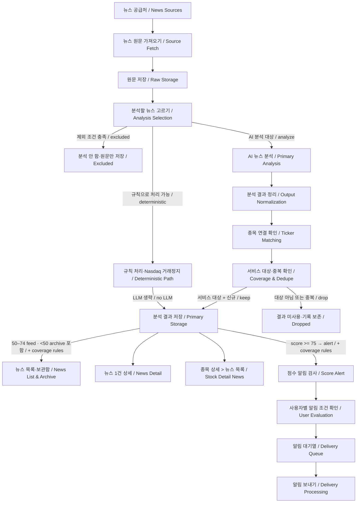

# News Primary Analysis — VERIFIED AS-IS

> **No inference.** 이 문서는 Architecture Map 3단계-B에서 완료한 뉴스 감사 결과만 기록한다. SERVICE MODEL이나 개선 제안이 아니다. 기준 commit은 `8cb52893a84c8de73051ae2b87427a054b9897cf`이다. 이번 문서 작성에서는 새 코드·DB 조사, 뉴스 수집, LLM, E2E를 실행하지 않았다.

| 상태 | 이 문서에서의 의미 |
| --- | --- |
| **VERIFIED CODE** | 감사에서 함수·호출·저장 계약·consumer 연결을 코드로 확인. 실행 또는 production 활성화의 증거는 아님 |
| **VERIFIED STORAGE** | 실제 뉴스 저장 row와 관계를 대조한 경우에만 사용. **이번 감사에서는 해당 항목 없음** |
| **UNKNOWN / TO AUDIT** | 실행·운영·정확도·저장 표본 등 미확인 영역 |

shared-local 조회 범위에서 뉴스 raw/event/AI 표본은 **0건**이었다. 따라서 아래 저장 경로도 모두 **VERIFIED CODE**이며, 뉴스 경로를 VERIFIED STORAGE 또는 E2E VERIFIED로 표시하지 않는다. 0건은 조회한 환경의 결과이지 다른 환경에도 데이터가 없다는 뜻이 아니다.

## 1. 쉬운 설명

뉴스는 공급처마다 목록과 본문을 가져오는 방법이 다르다. 가져온 기사는 공통 news ingest 안에서 원문을 저장하고 분석할 대상을 고른다. 제외된 기사는 원문만 남고, 일부 보관용 뉴스와 Nasdaq 거래정지 공지는 정해진 규칙으로 처리하므로 모든 뉴스가 LLM을 거치지는 않는다.

일반 뉴스 Primary는 Gemini에 직접 분석을 요청한다. 결과를 받은 뒤 출력 형태를 정리하고 ticker cache, 관련 ticker, coverage, 중복 여부를 확인해 사용자용 event를 저장한다. 저장된 결과는 Feed·뉴스 상세·종목 상세에서 읽으며, alert 등급 event는 별도 Score Alert batch가 소비한다. AI 실행 기록은 사용자용 event와 별도로 저장한다.

SEC의 raw ingest와 Workflow analysis selection을 분리한 구조를 그대로 복사한 경로가 아니다. 뉴스는 공통 ingest 안에 raw 저장과 분석 선택·실행이 이어지며, SEC의 family별 validation/repair를 공통으로 사용하는 것도 아니다. **Score Alert와 Monitor Alert는 별도 시스템**이다.

## 2. Mermaid — News Primary As-Is

아래 **모든 노드와 화살표는 VERIFIED CODE**다. provider 운영 활성화, 실제 저장·화면 실행, 외부 전달 성공은 UNKNOWN이다. 그림의 Raw Storage 이후 단계들은 공통 news ingest의 처리 흐름을 요약한다. Primary Storage는 저장 묶음의 역할이며 모든 분기가 같은 AI trace를 만들거나 전체 저장이 하나의 transaction이라는 뜻은 아니다.

**그림 읽는 법**

- 박스는 처리 단계, 화살표 라벨은 실제 확인된 주요 분기조건이다.
- 한국어는 빠른 이해를 위한 설명, 영어는 코드·개발 용어 대응이다. 세부 조건은 본문 표와 근거를 참조한다.
- 점수는 일반 등급 기준이며 coverage 예외가 추가 적용된다. 목록·보관함의 등급 표시는 배타적 분기가 아니며 alert 등급도 목록에서 조회될 수 있다. alert 등급은 외부 발송 성공을 뜻하지 않는다.
- `keep`의 신규는 해당 dedupe를 통과했다는 뜻이다. provider 간 동시 중복 방지와 실제 운영·발송 여부는 `TO AUDIT`로 유지한다.

- 수집 중 기존 raw/event를 확인해 불필요한 본문 hydration을 생략하는 경로도 있다. 그림은 그 세부 제어 흐름을 생략했다.
- prefilter 제외는 raw 보존, 분석 후 coverage/dedupe 제외는 raw metadata와 event 없는 AI trace 저장으로 구분한다.
- deterministic 분기는 event를 저장하지만 일반 LLM 실행 trace를 만들지 않는다.
- news ingest가 Score Alert를 즉시 호출하는 화살표는 없다. 별도 batch가 저장된 alert 등급 event를 선택한다.
- Delivery processing은 코드 연결만 확인했다. production scheduler 활성화와 Telegram/email 실제 발송 성공은 UNKNOWN이다.
- Monitor 내부와 Form 25 identity·ticker-change 관계는 그림에 포함하지 않는다.

### 확인된 진입점과 연결 근거

| 연결 | 감사에서 확인한 코드 근거 | 수준 |
| --- | --- | --- |
| Workflow → source runner → 공통 ingest | `workflows/source-ingest.ts`: `newsSourceIngestWorkflow`, `runNewsSourceIngestStep`, `NEWS_SOURCE_RUNNERS` → `lib/newsIngest.ts`: `runNewsIngestForSource` | VERIFIED CODE |
| API / cron 진입 | `app/api/sources/<source>/ingest/route.ts`, `app/api/cron/source-ingest/[lane]/route.ts`; 인증·lane 조건을 거치는 호출 | VERIFIED CODE; 실제 호출·운영 활성화 UNKNOWN |
| 원문 → 선택 → 분석 | `lib/newsIngest.ts`: `persistRawItem`, prefilter, deterministic 분기, `runNewsAnalysisForRawItem` | VERIFIED CODE |
| 일반 / Corporate Actions 분석 | `lib/ai/newsEventAnalysisPreview.ts`: `runNewsEventAnalysisForRawItem`; `lib/ai/nasdaqCorporateActionAnalysisPreview.ts` | VERIFIED CODE; 이름의 Preview가 debug 전용임을 뜻하지 않음 |
| 분석 → 저장 | `lib/newsIngest.ts`: `persistAnalyzedEvent`, `persistAiTrace` | VERIFIED CODE |
| 저장 event → Score Alert | `runAlertDeliveryBatch.ts` → `runAlertDeliveryForEvent.ts`; scheduler의 batch/queued 처리 연결 | VERIFIED CODE |

`lib/sourceWorkflowConfig.ts`의 `SOURCE_INGEST_AUTOMATIC_CRONS_ENABLED=false`와 감사 당시 `vercel.json`의 market cache / delivery cron 설정은 확인했다. 이 사실만으로 모든 외부 scheduler의 유무나 각 provider의 production 실행 여부를 확정하지 않는다.

## 3. Provider Layer

아래 12개 adapter는 source runner/API/Workflow 호출 연결을 확인한 **CODE WIRED**다. 수집 성공 또는 사용 중이라는 의미는 아니다. parser/fetch 구현은 `lib/sources/` 아래 source별 모듈, 공통 연결은 `lib/newsIngest.ts`와 `workflows/source-ingest.ts`가 근거다.

| Provider / source | 수집 방식 | 특별 처리 / fallback | 연결 | Production 활성화 |
| --- | --- | --- | --- | --- |
| GlobeNewswire | 검색 목록 → 기사 HTML | 기존 저장 여부에 따른 본문 hydration 선택 | CODE WIRED | UNKNOWN |
| Business Wire | RSS → 기사 HTML | 본문 hydration 선택·기존 기사 재사용 | CODE WIRED | UNKNOWN |
| PR Newswire | 복수 RSS → 기사 HTML | 기사 fetch의 최대 3회 시도·재시도 가능한 실패 처리 | CODE WIRED | UNKNOWN |
| Newsfile | Last 25 Stories RSS → 기사 HTML | 공통 ingest로 전달 | CODE WIRED | UNKNOWN |
| ACCESSWIRE / Access Newswire | newsroom API → 기사 HTML | 직접 조회 실패·hydration 문제 시 설정된 NAS fallback | CODE WIRED | UNKNOWN |
| OFAC / Treasury | 공식 목록 → 발표문 | source별 parser | CODE WIRED | UNKNOWN |
| DOJ | Justice press releases API | JSON 본문 사용 | CODE WIRED | UNKNOWN |
| DEA | DOJ press releases API 기반 별도 source | DEA 필터/분류 | CODE WIRED | UNKNOWN |
| White House | Presidential Actions / Fact Sheets / Releases HTML | 여러 공식 목록 처리 | CODE WIRED | UNKNOWN |
| FDA | Press / Drugs / Biologics / MedWatch RSS → HTML | 실패·본문 부족·요청 기사 누락 등에 NAS fallback | CODE WIRED | UNKNOWN |
| Nasdaq Trader | 공식 halt feed | 구조화 거래정지 정보의 deterministic 처리 | CODE WIRED | UNKNOWN |
| Nasdaq Corporate Actions | 공식 headlines RSS → notice HTML | 전용 Corporate Actions prompt 또는 보관 분기 | CODE WIRED | UNKNOWN |

NAS fallback은 `lib/newsIngestFallbacks.ts`의 기존 수집 보조 경로다. `ACCESSWIRE_INGEST_URL`, `FDA_INGEST_URL`, `NAS_INGEST_TOKEN` 설정을 사용한다. 감사에서 일부 로컬 파일의 설정 존재만 확인했으며 실제 실행 프로세스 적용·유효성은 UNKNOWN이다.

**FMP는 위 뉴스 기사 공급처가 아니라 market context source로 CODE WIRED**다. `lib/newsMarketContext.ts`가 quote/profile/shares float를 읽고 기존 ticker·market cache를 함께 사용한다. 이번 문서는 제거·대체 여부를 다루지 않는다.

## 4. Identity / Ticker Matching

| 단계 | 실제 코드 동작 | 근거 / 제한 |
| --- | --- | --- |
| Source/body ticker | source parser가 만든 본문 ticker를 입력의 `body_tickers`로 전달 | `newsEventAnalysisPreview.ts`: `buildInputFromGlobeRawItem`; 함수 이름과 달리 공통 뉴스 입력에 사용 |
| Metadata ticker | provider metadata ticker는 debug 정보로 분리 | 본문 근거와 동등한 권위 source로 간주하지 않음 |
| LLM primary / related ticker | LLM이 primary·관련 ticker를 출력. prompt는 명확한 회사 식별과 관련 ticker 추론을 허용 | `lib/prompts/newsEventAnalysis.ts`; parser만으로 종목을 확정하는 구조가 아님 |
| Active ticker cache | 출력 symbol을 active ticker cache와 대조하고 equity/미국시장 조건 등을 적용. unresolved symbol은 제거하고 primary는 null이 될 수 있음 | `lib/tickerCanonicalizer.ts`: `canonicalize` 경로; metadata에 correction/unresolved/error 기록 |
| 공식 Nasdaq CA ticker | cache 단계에서 제거된 공식 Corporate Actions ticker를 복원하는 별도 처리 | `lib/newsIngest.ts`: `restoreNasdaqCorporateActionOfficialTickers` |
| Proxy ticker | LLM related ticker가 비어 있는 경우 관련 proxy를 보완. non-company scope·점수 조건과 active equity 분류 사용 | `lib/newsTickerProxies.ts`; theme/sector 후보와 생성 근거 metadata |
| Unresolved / coverage | company news의 유효한 미국 ticker 부재, broad scope 점수·proxy 조건 등을 확인해 event 저장을 제외할 수 있음 | `apply` coverage 경로는 `lib/newsIngest.ts`; ticker 없는 일부 FDA clinical 예외는 archive 처리 |

**Symbol cache 확인은 issuer 독립 검증과 같지 않다.** 회사명 표시용 `lib/newsCompanyIdentity.ts`도 회사명에서 검증된 issuer/ticker identity를 확정하는 공통 resolver라는 의미가 아니다. 여러 종목은 primary·related·proxy 역할을 구분해 `event_tickers`에 기록한다.

- **Form 25 Human Override → 뉴스 ingest identity: NOT WIRED.** 공통 consumer에 Form 25 처리가 있어도 일반 뉴스 identity에 override를 적용한다는 뜻은 아니다.
- **Ticker-change effective reader → 뉴스 ingest identity: NOT WIRED.** 이미 구현된 ticker projection을 뉴스 연결에도 사용한다고 일반화하지 않는다.
- `needs_human_review` 출력/저장 flag는 확인됐지만 뉴스 Human Review queue나 실행 차단 workflow까지 확인된 것은 아니다.

## 5. Dedupe

| 층 | 확인된 기준 / 저장 계약 | 제한 |
| --- | --- | --- |
| Source list | source별 목록 중복 정리와 공통 기존 raw/event lookup을 통해 hydration·재처리 선택 | provider마다 동일한 기사 identity를 공유한다고 확인하지 않음 |
| Raw identity | `source_code + source_unique_id` 또는 `source_code + dedupe_key`; 해당 조합의 unique 계약 | source 간 공통 본문 identity가 아님 |
| Event identity | `source_group + group_dedupe_key`; 기존 event 재사용 또는 upsert | force/replay를 모두 append-only라고 부를 수 없음 |
| Company-news cross-group | ticker + event type + 정규화 title 기반 key | 기사 의미 전체의 동일성을 보장하는 규칙은 아님 |
| Sector/theme/macro | source·scope·type·날짜·제목 topic token key, 실행 내 token 유사도 비교 | source를 포함하는 조건과 실행 내 비교 범위가 있음 |
| Delivery | `user_alert_deliveries`의 user + dedupe key 계약, event 처리 기록 | 실제 provider 전송까지의 중복 방지 실행은 미검증 |

근거: `lib/newsIngest.ts`의 raw/event lookup, group/cross-group key, in-run dedupe와 저장 호출. `events.cross_group_key`는 unique 보장이 아닌 조회 index이므로 **provider 간 동시 ingest 완전 중복 방지는 UNKNOWN**이다. **본문 hash 기반 공통 dedupe는 확인되지 않았다.**

## 6. Analysis / Retry / Validation

### 실제 분석 입력과 경로 — VERIFIED CODE

일반 입력에는 source code/name, URL, 발행 시각, 제목, 준비된 본문, body ticker, metadata debug 정보, market context가 포함된다. 본문은 준비된 analysis text → 본문/teaser 등의 경로를 사용하고 모델용 길이 제한을 적용한다. source별 본문 준비가 있으므로 원문 HTML 전체를 그대로 보내는 공통 구조가 아니다.

`newsEventAnalysisPreview.ts`의 공통 입력 생성 → `lib/prompts/newsEventAnalysis.ts`의 사용자 JSON/output contract → `lib/ai/newsGeminiAnalysis.ts` → `lib/ai/geminiStructuredJson.ts` 호출을 확인했다. ticker 기반 market context는 최대 6개 symbol을 대상으로 기존 cache 및 FMP 조회를 사용한다. 관련 과거 뉴스/SEC 공시를 이 LLM 입력에 조회해서 넣는 연결은 확인하지 않았다.

일반 뉴스는 별도 LLM router 없이 direct analysis다. Nasdaq Corporate Actions는 전용 입력/prompt를 사용하는 별도 분기다. 출력에는 event type, score/signal, market scope, 설명·근거, ticker, calendar/offering 및 routing 관련 값이 있다. 일반 delivery 등급은 score 75 이상 alert, 50 이상 feed, 그 미만 archive이며 coverage와 ticker 없는 clinical 예외 처리도 존재한다.

| 처리 층 | 확인한 동작 | 상태 |
| --- | --- | --- |
| Provider fetch retry | source별 timeout·재시도 가능한 hydration, PR 기사 3회 시도, Access/FDA의 NAS fallback을 구분 | VERIFIED CODE; 모든 provider 공통 retry 횟수 없음 |
| Gemini HTTP execution | `runStructuredGeminiJson`의 단일 generateContent HTTP 실행; 뉴스 wrapper에 별도 transport retry loop 없음 | VERIFIED CODE |
| JSON extraction | JSON 응답 파싱, fence/object 추출 fallback | VERIFIED CODE; semantic repair가 아님 |
| Output normalization | ticker/배열 정리, routing validation, calendar policy, offering terms 정규화 등 | VERIFIED CODE; 모든 의미 오류를 검증하는 공통 schema/semantic validator로 일반화하지 않음 |
| Semantic repair | 뉴스 경로에서 오류 내용을 다시 LLM에 보내 교정하는 연결 없음 | NOT WIRED |
| Workflow retry | `runNewsSourceIngestStep.maxRetries = 3`; durable Workflow 단계의 재시도 | VERIFIED CODE; 한 기사에 항상 실행되는 LLM 재시도 횟수가 아님 |

Prompt에 output contract가 있고 Gemini의 JSON MIME 설정을 사용하지만 뉴스 wrapper가 transport의 `responseSchema`를 전달하는 것은 아니다. SEC의 validation/repair와 같은 보장으로 설명하지 않는다.

일반 분석 실패 분기는 실패 결과를 기록하고 다음 기사로 진행한다. 이 분기가 성공 경로의 `persistAiTrace`를 항상 호출하는 것은 아니다. 분석 성공 후 coverage/dedupe 제외와 LLM 실패를 같은 저장 형태로 취급하지 않는다. 또한 `dryRun`도 LLM 실행을 허용할 수 있으므로 read-only 감사 수단으로 실행하지 않았다.

## 7. Storage — 모두 VERIFIED CODE

아래는 코드상 저장 역할과 consumer 계약이다. **이번 감사에서 뉴스 row 실측은 없으며 VERIFIED STORAGE 항목은 없다.**

| 저장 | 역할 / 저장 호출 | 다음 소비 |
| --- | --- | --- |
| `sources` / `source_runs` | source 참조 upsert, 실행 상태·집계; `ensureSourceReference`와 source run 시작/완료 | ingest 실행 관리. 참조의 enabled/runtime owner 값은 production 실행 증거가 아님 |
| `raw_items` | 원문 URL·제목·시각·body/analysis text·raw payload, parser/ticker source·fetch 실패·skip metadata; `persistRawItem` | 분석 입력, 재처리, 원문 표시 |
| `events` | 사용자용 제목·요약·이유·score/signal·등급·ticker·scope 및 분석 metadata; `persistAnalyzedEvent` | Feed, 뉴스/종목 상세, Score Alert 대상 선택 |
| `event_analysis` | why it matters, bullish/bearish, key evidence, watch next 등 상세 결과 | News Detail 등 상세 reader |
| `event_tickers` | primary/related/proxy symbol과 role. 기존 관계 교체 후 `(event_id, symbol, role)` 기준 저장 | 관련 종목·뉴스 조회, event ticker 소비 |
| `ai_runs` | prompt/version, model, 사용량, raw/event 연결과 실행 기록 | AI 실행 추적. news trace의 `route_classification`은 null |
| `ai_outputs` | `news_event_analysis` payload에 정규화된 analysis와 최초 `output_text` 저장 | 분석 결과/원래 출력 추적. 전체 prompt·repair trace 공통 보존을 뜻하지 않음 |
| 확인된 파생 저장 | offering terms, calendar 저장 호출과 Monitor foundation/child enqueue 연결 | 연결 존재만 확인; Structured Data/Monitor 내부는 범위 밖 |
| Score Alert 관련 저장 | event 처리 기록 `alert_delivery_event_runs`, 사용자 delivery/queue 및 dedupe 계약 | batch 평가와 queued delivery processing |

일반 성공 경로는 event 저장 후 AI run/output에 새 ID를 부여한다. 분석 후 제외는 event ID가 없는 trace를 남길 수 있다. raw/event 및 상세 관계는 재사용·upsert/교체 경로가 있어 **전체 뉴스 ingest/re-analysis를 append-only라고 일반화하지 않는다.**

## 8. Consumers — VERIFIED CODE, 브라우저 E2E UNKNOWN

| Consumer | 실제 reader / 입력 | 확인 범위 |
| --- | --- | --- |
| Feed | `lib/liveFeed.ts`, Feed V2/API → events reader | source/등급·ticker 없는 broad news 조건을 적용한 저장 event 소비 |
| `/news` | `app/news/page.tsx` → `lib/newsV2Data.ts` → `search_news_v2`, `get_news_v2_facets` RPC | 저장 뉴스 검색·facet. 일반 non-archive 및 broad scope 점수 필터 등 별도 목록 조건 |
| News Detail | `app/news/[id]/page.tsx` → `lib/newsAnalysisDetail.ts`: `loadNewsAnalysisDetail` | events → event_analysis/event_tickers/raw; 근거·저장 원문·market context·관련 정보 |
| News Archive | `app/news/archive/[id]/page.tsx` | 별도 archive 상세 경로 |
| Stock Detail News & Events | Watchlist V2/stock overview → `/api/events?ticker=...&include_archive=true` → `fetchEvents` | 종목별 저장 event 조회 |
| Related news/events | `lib/supabase.ts`: `fetchEventsByTicker` → `resolveIssuerLinkedTickers` | active catalog의 SEC CIK와 catalog 정책 기반 관련 ticker 조회. effective ticker-change reader 사용으로 간주하지 않음 |
| Score Alert | `runAlertDeliveryBatch` → `runAlertDeliveryForEvent` → 사용자 평가/queue; `runAlertDeliveryScheduler` → queued 처리 | 저장된 alert 등급 event가 대상. news ingest에서 즉시 전송하는 구조가 아님 |

News Detail의 저장 원문 추출은 `lib/originalSourceContent.ts`의 `readStoredNewsSourceContent` 경로다. 코드의 fixture 분기는 실제 제품 E2E 증거로 사용하지 않는다.

Score Alert의 common event normalization은 뉴스의 저장 ticker/event ticker를 사용한다. Form 25 전용 identity 처리가 공통 함수에 있더라도 일반 뉴스 identity에 연결됐다는 의미는 아니다. Telegram/email delivery 코드는 존재하지만 이번 감사는 실제 외부 요청·전송·수신을 검증하지 않았다. Monitor Alert 내부는 별도 조사 범위다.

## 9. Verification Evidence

- **Verified commit:** `8cb52893a84c8de73051ae2b87427a054b9897cf`.
- **근거 범위:** 3단계-B에서 현재 main의 source adapter, 공통 news ingest, Gemini 입력/실행, normalization, persistence와 consumer 호출을 대조했다. 이 문서는 그 완료된 결과만 옮겼다.
- **기존 DB 대조 결과:** shared-local에서 `source_group=news` raw/event는 0건, 뉴스 AI output/run 표본도 0건이었다. source 참조의 뉴스 표본도 없었다.
- **VERIFIED STORAGE:** 없음. 저장 함수와 schema/unique 계약을 확인한 것만으로 실제 뉴스 저장 경로를 승격하지 않는다.
- **새 fetch / LLM / ingest / Product E2E:** 실행하지 않음. 현재 화면·운영 전달을 E2E VERIFIED로 표시하지 않는다.
- **문서에 사용한 검증 수준:** VERIFIED CODE와 UNKNOWN / TO AUDIT. DB의 0건 관측은 저장 성공 표본을 대신하지 않는다.

## 10. UNKNOWN / TO AUDIT

| 영역 | 남겨 둔 미확인 사항 |
| --- | --- |
| Provider production 활성화 | 어떤 source가 실제 scheduler에서 실행 중인지, 실제 credential/runtime config 적용과 유효성, 외부 scheduler 상태 |
| 실제 저장 표본 | raw → event → AI trace → consumer의 뉴스 row 대조; 성공·실패·deterministic 각 실행 표본 |
| Ticker identity 정확도 | 실제 기사에서 primary/related/proxy가 올바른 회사·증권인지; symbol cache 확인만으로 입증하지 않음 |
| 동시 provider dedupe | 서로 다른 source/URL의 동시 처리에서 완전한 중복 방지가 되는지 |
| Human Review | 뉴스의 `needs_human_review`에서 실제 queue·승인·차단·effective consumer까지의 운영 흐름 |
| 실제 UI | Feed/News Detail/Archive/Stock Detail의 현재 저장 데이터 기반 브라우저 E2E |
| 외부 delivery | scheduler의 실제 활성화, queue 처리·Telegram/email 전달 성공, provider 단계 중복 방지 실행 |
| Monitor 내부 | news 저장 후 발견된 연결의 내부 평가·저장·Alert 동작. 이번 Primary 감사에서는 추적하지 않음 |

Form 25 Human Override와 ticker-change effective reader의 **뉴스 identity NOT WIRED**는 위 UNKNOWN을 추측으로 채우기 위한 제안이 아니다. 이 문서는 실제 연결이 확인된 노드·화살표만 기록하며 새 구조 개선안은 포함하지 않는다.
