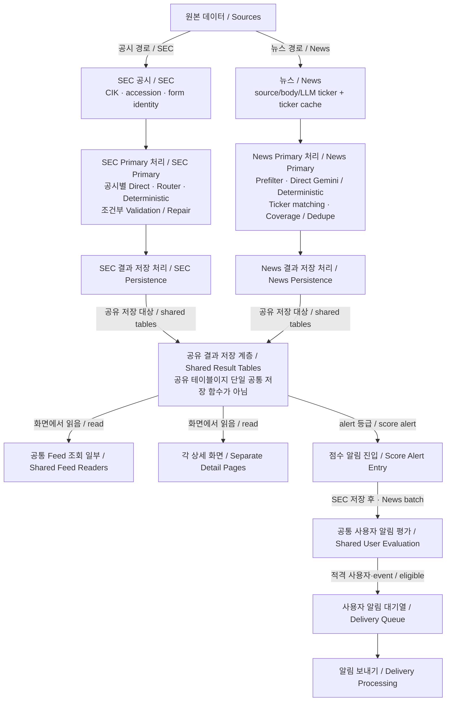

# Primary Analysis — 상위 지도 / Overview

> **No inference.** 기존 SEC·News As-Is 문서와 3단계-C 비교 결과를 요약한 지도다. 상세 구현도나 새 설계안이 아니다. 기준 commit은 `8cb52893a84c8de73051ae2b87427a054b9897cf`이며, 이번 작성에서 새 코드·DB 조사 또는 제품 실행을 하지 않았다.

## 1. 목적과 상위 지도

**Primary Analysis는 SEC 공시와 뉴스를 투자자가 읽을 분석 결과로 만들어 화면과 Score Alert에 제공한다.** SEC와 News는 각자 다르게 처리하며, 일부 저장 테이블·Feed reader·Score Alert 계층을 공유한다. Primary Analysis라는 이름이 하나의 공통 실행 함수를 뜻하지는 않는다.

그림의 Sources 분기는 source 유형을 나눈 개념적 분류다. 나머지는 상세 감사의 **VERIFIED CODE** 연결을 묶은 표현이며 production 실행 성공을 뜻하지 않는다.

**그림 읽는 법:** 박스는 처리 역할, 한국어는 쉬운 설명, 영어는 개발 용어 대응이다. 화살표는 주요 데이터 전달·소비 관계다. 화면과 Score Alert는 저장 결과를 **각자 읽으며**, 화면이 알림 평가를 실행하는 순서가 아니다.

**UNKNOWN:** 공통 identity resolver는 확인되지 않았다. **Form 25 Human Override → News matching은 NOT WIRED**다. 운영 scheduler 활성화·외부 발송 성공도 UNKNOWN이다.

**별도 시스템 / Separate Monitor Alert:** 사용자 Monitor 조건·Matcher 기반 알림은 이 그림 밖의 별도 시스템이다.

## 2. SEC와 News의 핵심 차이

| SEC Primary | News Primary |
| --- | --- |
| raw ingest와 Primary 분석이 별도 단계이며 Workflow가 연결 | 공통 news ingest 안에서 raw 저장·분석 선택·분석 진행 |
| 공시별 source preparation, Direct / Router-first / EFFECT deterministic | source별 본문 준비, Prefilter / Direct Gemini / deterministic archive·Nasdaq halt |
| family별 diagnostic-only 또는 조건부 semantic repair | 결과 normalization·ticker matching·coverage/dedupe; semantic repair LLM은 NOT WIRED |
| 공시 identity와 일부 Form 25 effective identity/review 경로 | source/body/LLM ticker와 active cache·related/proxy 처리 |

## 3. 실제 공유 구현

- **결과 저장 대상:** `events`, `event_analysis`, `event_tickers`. SEC와 News가 각자 저장한다. **공유 테이블이지 단일 공통 저장 함수가 아니다.** payload 의미·갱신·실패 처리가 모두 같은 것도 아니다.
- **별도 실행 이력:** `ai_runs`, `ai_outputs`도 저장 대상을 공유하지만 사용자 표시 결과와 다른 역할이다. 모든 분기·실패가 같은 trace를 남기는 것은 아니다. 개요도에서는 별도 노드를 생략했다.
- **Feed 일부:** `lib/liveFeed.ts` 등 저장 event를 읽는 공통 코드. source별 조건과 각각의 상세 reader/UI는 유지된다.
- **Score Alert:** SEC는 적격 분석 저장 후, News는 저장 event를 고르는 batch를 거쳐 `runAlertDeliveryForEvent`의 공통 사용자 평가·delivery 계층으로 연결된다. SEC에도 batch 경로가 있다. 그림의 Score Alert Entry는 이 서로 다른 진입을 묶은 역할이지 새 공통 후보 선정 함수가 아니다.

일반 점수 등급과 source별 예외·억제·identity/analysis gate, 사용자 조건을 거쳐야 queue에 들어간다. alert 등급 자체는 즉시 전송·외부 수신 성공을 보장하지 않는다.

## 4. 공유하지 않는 것과 미확인 연결

SEC/News ingest, 입력 준비, identity, 분석 runner, validation/repair, persistence 함수, 상세 화면은 하나로 합치지 않는다. `raw_items`를 함께 써도 원문 payload·identity·보존 범위가 같다고 할 수 없다.

Form 25 Human Override와 ticker-change effective reader는 **News ingest identity에 NOT WIRED**다. 뉴스의 symbol cache 확인을 issuer/security 독립 검증으로 표현하지 않는다. Human Review를 두 경로의 필수 공통 단계로 넣지 않는다.

## 5. Verification level

| 수준 | 확인된 범위 |
| --- | --- |
| **VERIFIED CODE** | 기준 commit에서 감사한 SEC/News 처리·저장·reader·Score Alert 호출 연결. 위 그림은 이 범위의 상위 요약 |
| **VERIFIED STORAGE — SEC만** | 기존 T2 Biosystems Form 25, Gulf Resources 10-Q, CXJ Group NT 10-K의 3건 표본에 한정 |
| **News — CODE만 확인** | shared-local 뉴스 raw/event/AI 표본 0건. 뉴스 저장 성공·화면 E2E로 승격하지 않음 |
| **UNKNOWN / TO AUDIT** | production 활성화, 실제 외부 전달, 뉴스 저장·identity 정확도·동시 provider dedupe·Human Review, 미검증 SEC family 실행 및 전체 Primary Product E2E |

**Primary 전체 Product E2E 완료를 뜻하지 않는다.** 이번에 새 ingest·LLM·브라우저 제품 E2E를 실행하지 않았다. 문서 Mermaid 렌더링은 제품 검증과 별개다.

## 6. 상세 문서

- [00 Service Model](00-service-model.md) — 상위 개념과 용어; 구현 검증과 구분.
- [01 SEC Primary As-Is](01-primary-analysis.md) — 공시별 처리·repair·저장·consumer 근거.
- [01b News Primary As-Is](01b-news-primary.md) — provider·identity·coverage/dedupe·저장·consumer 근거.
