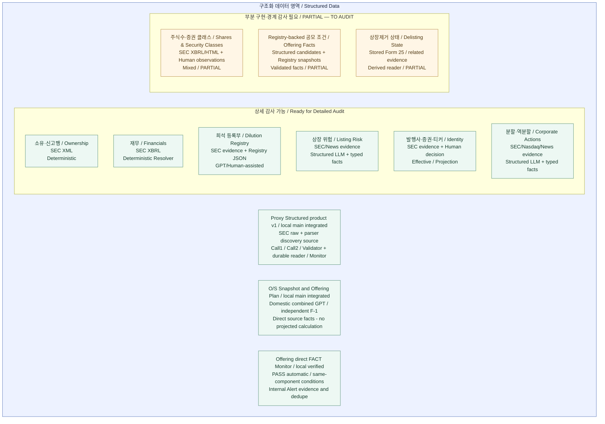

# Structured Data — 도메인 inventory

> **No inference.** 이전 도메인 inventory에 날짜별 local main 확인 범위를 추가한다. 최신 Offering/O/S 추가 범위는 2026-10-13 절에 한정한다. 전체 도메인의 처리 흐름·권위 source 우선순위·production 활성화를 확정하는 지도가 아니다.

## 쉽게 읽기

Structured Data Pipeline은 공시를 설명하는 글을 만드는 Primary Analysis와 달리, 종목 상세와 Monitor가 다시 사용할 숫자·상태·근거를 만드는 영역이다.

처리 방식은 하나가 아니다. XML/XBRL의 deterministic parser, 구조화를 위한 LLM 분석, GPT/Human-assisted 관리, Human Review를 반영한 Effective Value, 원본을 보존하는 Projection 등이 있다. **모든 도메인이 이 모든 방식을 사용하지는 않는다.** 아래 지도는 각 영역의 존재와 확인된 처리 방식을 구분할 뿐, 그 사이의 실행 순서를 표현하지 않는다.

## 검증 범위

- 기준 코드: `8cb52893a84c8de73051ae2b87427a054b9897cf`. Inventory 확인 당시 main: `7a53848a43436aceb591b12eebeaa6c64111708a` — Architecture Map 문서 기준점.
- 근거 수준: **CODE EXISTS**, 그리고 직접 호출을 확인한 일부 **WIRED — CODE**. 저장 구조는 코드·migration 선언의 존재를 뜻한다.
- 위 inventory 감사 당시 **STORAGE VERIFIED / PRODUCT E2E VERIFIED가 아니었다.** 아래 Proxy 및 날짜별 Offering/O/S 추가 행은 별도의 local 코드·저장·실행·브라우저 근거를 가진다. 나머지 도메인은 기존 범위를 유지한다.
- Proxy 기준: main merge `53e1f79098563a0ac6e761d900ada2fbf623c0ae`. 이번 동기화는 현재 코드와 보존 검증 자료만 사용하며 새 DB/모델/제품 실행을 하지 않는다.

### Proxy Structured product v1 — local main 통합 완료

Primary와 Structured는 같은 Proxy Parser/discoveryBlocks source 선택 계약을 사용하지만 별도 분석이다. Primary는 discoveryBlocks 순서·원문·ID·좌표·경계를 1:1 전달하며 기존 보조자료를 유지한다. Structured는 `Call 1 → Call 2 → Validator → durable persistence → official reader → deterministic Monitor Matcher → internal Alert`다. canonical은 검증된 Call2 FACT만; Call1 handoff/trace/source evidence는 분리한다.

provider checkpoint/uncertain은 불확실한 호출의 자동 재호출을 막는다. official reader는 source fingerprint·contract version·저장 hash와 두 frozen validator를 재검증하며, 미완료·실패·stale·uncertain은 unavailable이다. Monitor에는 typed boolean `proxy.has_proposal`, `proxy.has_capital_structure_proposal` 두 개만 연결한다. 안건 존재를 승인·실행·발행으로 승격하지 않는다.

Local automatic filing → internal Alert E2E 및 재실행 dedupe/멱등성 PASS. 양성 자동 E2E는 합성 filing + 보존 응답 replay이고, 실제 Alternus/BigBear fresh 분석 검증은 별도다. main reader/인증 UI smoke와 migration `20261005043414` 객체/history 정합 확인 완료. **push/deploy 및 외부 email/Telegram 완료 아님.** 세부 근거·한계는 [Proxy 제품 문서](../proxy-structured-product-v1.md)를 참조한다. 전체 연결 Mermaid는 [SEC Primary 지도](01-primary-analysis.md)의 기존 도식 한 곳에서 관리한다.

### S-4/F-4 evidence 및 EFFECT — 2026-10-06 local main

통합 기준 `def887903bb4fedf2bfa8d9d2f6a7af04b69d8e3`. S-4/F-4는 새로운 merger FACT schema가 아니다. 독립 Core Selector/Evidence Index/MCP가 저장 원문의 선택 근거를 제공하고, Monitor는 완료된 Primary event의 정확한 제출 form만 읽는다. EFFECT도 새 Structured LLM 도메인이 아니라 원본 XML과 선택한 등록 근거의 deterministic reader/Matcher 연결이다. 두 경로 모두 Primary prose/score를 FACT 근거로 쓰지 않는다.

| 경로 | 저장·reader | Consumer와 검증 범위 |
| --- | --- | --- |
| S-4/F-4 | 기존 raw 및 Primary event/run; `readEventFilingMetadata`; source-only MCP search/read | `event.sec_form` eq/in 네 form의 제출/정정 발생만. 기존 5건/15 MCP query PASS; event 없는 raw 제외 |
| EFFECT | `raw_items.documents[].effectOriginalSource` XML/URL/hash; `readEffectFacts`; 기존 `user_alert_deliveries`의 match evidence/registration key | 명시적으로 확인한 CIK/file number/form/accession 대상만. RPC가 원본/대상 재검증 및 등록별 중복 방지; `/monitor`·`/alerts` 재사용 |

Local migration `20261005183052` 적용 및 main 기존 데이터 보존 확인. 합본 회귀 243건, main 집중 회귀 94건·typecheck·인증 화면 검증 PASS. [EFFECT 기록](../effect-registration-monitor-v1.md)은 fresh 후보 E2E와 합본 replay/main read-only smoke를 구분한다. 기존 inventory의 다른 UNKNOWN은 유지한다. 전체 연결 도식은 [SEC Primary 지도](01-primary-analysis.md)의 기존 Mermaid가 단일 원본이다. 생산 환경 활성화는 별도다.

### Offering / O/S / direct FACT Monitor — 2026-10-13 local main

통합 `7651dad7`, 정리 후보 `eac0545b`. S-1/S-1A/S-3/S-3A/424B3/424B5는 원문에서 GPT 1회로 O/S와 Offering 결과를 만들고 각각 검증·조회한다. F-1/F-1A는 기존 독립 추출을 유지한다. Primary와 Registry의 목적·기존 실행 계약은 그대로다.

PASS는 관리자 개입 없이 direct FACT reader → 기존 Matcher → internal Custom alert로 이어진다. REVIEW_REQUIRED만 기존 예외 검토를 사용하며 hold/reject는 차단한다. 조건은 같은 component의 직접 수량·seller·security·unit이며, 희석률/ADS/워런트 합산 계산은 없다. 공시 event는 여전히 필요하다. `ai_runs`/`ai_outputs`의 불변 결과와 exact source binding, 기존 관리자 결정 이력, Alert evidence를 구분한다.

[상세 구조도·코드 경로·migration·검증](../../operations/OFFERING_PLAN_MONITOR_DIRECT_FACTS.md)이 연결 Mermaid의 단일 원본이다. 실제 iBio source/보존 응답과 TEST ONLY 접수번호·날짜로 자동 저장→알림 양성·replay 0을 검증했으며 fresh 모델 호출과 구분한다. 합본 회귀/typecheck/build, main 코드의 로그인/격리 DB 화면 및 main DB 기존 알림 readback 완료. 다른 도메인의 UNKNOWN이나 SEC 전체 완료 상태를 바꾸지 않는다.

## 도메인 지도 / Domain Inventory

**아직 전체 lifecycle로 확대 금지 / TO AUDIT:** 신규상장, 일반 merger, 전체 delisting lifecycle. 이 세 번째 상태 그룹은 조사 경계이며 도메인 박스로 추가하지 않는다.

박스는 도메인, 기존 그룹은 원래 상세 감사 준비 수준이다. `상세 감사 가능`은 구현 완료나 제품 E2E PASS를 뜻하지 않는다. Proxy와 Offering/O/S 추가 박스는 각각 별도의 dated local 근거를 갖는다. 한국어는 빠른 이해용 설명, 영어는 기술 용어 대응이다. 화살표는 **0개**이며, 박스의 위치도 의존관계·권위·처리 순서가 아니다.

## 확인된 도메인

날짜별 추가 행 외 consumer는 이전 감사에서 직접 확인한 호출자만 적었다. 날짜별 local 검증은 해당 행과 추가 절에 명시한다. 코드 참조나 local E2E가 배포 환경의 전체 production 경로를 검증한 것은 아니다.

| 도메인 | 목적 | 주요 Source | 현재 확인된 처리 방식 | 저장 구조 존재 여부 | Reader 존재 여부 | 확인된 Consumer | 현재 검증 수준 |
| --- | --- | --- | --- | --- | --- | --- | --- |
| Ownership | 거래·예정 매도·보유 신고행과 공시 이력 | Form 3/4/5/144, SC13 공식 XML | Deterministic parser; 신고행·정정/current-state 처리 | 있음: Form 4/144 행 저장, `sec_section16_*`, `sec_sc13_*` 선언 | `readCurrentOwnershipFacts`, Section 16 accession/current-state reader, SC13 current-state reader | Listing Matcher/Alert의 Form 4/144 입력, Section 16 Matcher, SC13 종목 조회 API·Monitor 소비 코드 | CODE EXISTS; 일부 WIRED — CODE. DB/E2E UNKNOWN |
| Financials | 매출·영업손익·순손익·영업현금흐름·현금의 기간별 재무값 | SEC CompanyFacts JSON, filing XBRL | Deterministic resolver/history | 있음: filing ledger, company facts, structured raw source; Monitor 결과의 AI 실행 envelope 사용 | `resolvePeriodicFinancials`, `resolvePeriodicFinancialHistory`, `readCurrentPeriodicFinancialFacts` | 종목 재무 API, Financial Monitor 입력·Alert 소비 코드 | CODE EXISTS; 일부 WIRED — CODE. DB/E2E UNKNOWN |
| Shares / O/S / Security Classes | 증권 클래스·시점별 주식수 근거 | SEC XBRL, prospectus HTML, structured 후보, Human observation | Deterministic 추출 + 품질 조건을 적용한 후보/Human 처리 | 있음: `share_count_history`, `issuer_common_class_universe_snapshots` 선언 | `readShareCountHistory`, class-share resolver, issuer-total aggregator | Stock Dilution 조회 코드에서 참조 | PARTIAL; CODE EXISTS 및 소비 참조 확인. source 우선순위·전체 경로 UNKNOWN |
| Dilution Registry | 증권별 발행 조건·잔여량·활동 snapshot | SEC 근거를 참조하는 Registry JSON | GPT/Human-assisted 입력 계약 + 검증·적용. GPT 생성 실행 자체는 미검증 | 있음: `dilution_instruments`, snapshots, activity, totals 및 조정 관련 선언 | `fetchStockDilution`, Registry-backed Offering reader | 종목 Dilution API, Registry-backed Offering Monitor 입력 | CODE EXISTS; 일부 WIRED — CODE. DB/E2E UNKNOWN |
| O/S Snapshot / Offering Plan direct FACT | 공시별 직접 O/S와 공모 계획·조건·원문 보존 | 저장된 SEC 원문, exact accession/source binding | Domestic 독립 공통 GPT 1회 + 분리 검증; F-1 독립 도메인 추출; 계산 없음 | `ai_runs` checkpoint / `ai_outputs` 불변 domain 결과 / 기존 결정 이력 / Alert match evidence | combined/source reader, `readOfferingPlanFacts`, owner Alert/current-validity reader | 기존 관리자, typed 동일-component Monitor, Custom alerts | Local main CODE/DB/retained-response automatic E2E/BROWSER PASS. Fresh 모델 평가와 생산 환경 활성화는 별도 |
| Offering Facts | 공시 accession별 공모·발행 조건 | 같은 accession의 Registry snapshot | 현행 Registry adapter; 옛 Gemini Stage 2 실행·application promotion 제거 | Registry snapshot; 역사 전용 `event_offering_monitor_canonical` 보존 | 현행 `readRegistryBackedOfferingFacts`; 역사 전용 `readOfferingMonitorCanonical` | Registry → 순수 Offering Matcher → 내부 Alert. 현행 경로에서 역사 reader import 없음 | 일부 WIRED — CODE; ATM/non-ATM 의미 매핑은 unavailable 유지. 오프라인 fixture 검증, 실제 DB/UI E2E 미검증 |
| Listing Risk | 상장 위험의 사건·상태·거래소·증권·날짜 | SEC/News에서 준비한 근거 | Structured LLM 분석 + validation + typed facts | 있음: `event_listing_risk_results`, `event_listing_risk_facts` 선언 | `readCurrentListingRiskFacts` | Listing Monitor Matcher/Alert | CODE EXISTS; analyzer·persistence 호출과 reader 소비 일부 WIRED — CODE. DB/E2E UNKNOWN |
| Proxy Structured | 공시별 제안 FACT와 source/evidence history | 저장 SEC raw → Proxy Parser / discoveryBlocks | 별도 Call1 → Call2 → Validator; Primary와 독립 | `ai_runs` stage checkpoint / `ai_outputs`: canonical은 검증된 Call2만 | `readProxyStructured`, `readProxyAccession`, `readCurrentProxyFacts` | typed boolean 2개 → Generic Matcher/internal Alert; `/monitor`, `/alerts` | Local main CODE/STORAGE/automatic E2E PASS (합성 source + 보존 응답 replay); 실제 Alternus/BigBear fresh 분석 별도 검증. Production 미검증 |
| Delisting State | 특정 증권·거래소의 상장제거와 거래정지 구분 | 선택된 저장 Form 25, 관련 공시·Listing Risk 근거 | Deterministic 파생 reader; 자동 실행 결과/실패 기록 | 독립 current-state 테이블은 확인되지 않음. 실행 기록은 `source_runs.metadata.form25_delisting` | `readStoredDelistingState` | ingest/replay 자동 trigger 호출 확인; 상태 UI 소비는 미확인 | PARTIAL; 일부 WIRED — CODE. 전체 상폐 lifecycle·DB/E2E UNKNOWN |
| Issuer / Security / Ticker Identity | 관측된 identity 근거, ticker 관계와 Human 판정을 분리 | SEC cover XML/XBRL, 공식 변경 근거, Human decision | Observation, deterministic resolution, Human-effective reader, projection 구성요소 | 있음: cover observations, ticker security/evidence/resolution/human decisions, Form 25 identity evidence/decisions 선언 | cover reader, effective ticker-resolution reader, product projection, effective Form 25 identity reader | Admin, 검색·상세, Watchlist, 종목별 Alert adapter 등에서 코드 참조 확인 | CODE EXISTS; 일부 WIRED — CODE. Human decision을 읽는 Effective Value 확인. DB/E2E UNKNOWN |
| Corporate Actions — Split / Reverse Split | 분할·역분할 조건과 실행 근거 | SEC/Nasdaq/News 근거를 받는 계약 | Structured LLM + 검증된 typed facts + deterministic 실행 판정 | 있음: `event_corporate_action_results`, `event_corporate_action_facts` 선언 | `readCurrentCorporateActionFacts`, `readStockSplitExecutions` | Listing Matcher/Alert, 주식수 기준 정규화·Dilution projection 코드 참조 | CODE EXISTS; 일부 WIRED — CODE. DB/E2E UNKNOWN. 일반 merger로 확대 불가 |

### 기존 감사에서 확인한 코드 식별자

다음은 재조사 결과가 아니라 inventory 근거를 찾기 위한 기존 식별자다. 목록 순서는 실행 순서가 아니다.

| 도메인 | 기존 감사 근거 |
| --- | --- |
| Ownership | `lib/monitor/ownershipParserFacts.ts`, `lib/monitor/ownershipMonitorPersistence.ts`; `lib/sec-section16-xml/persistence.ts`, `currentState.ts`; `lib/sec-sc13-xml/currentState.ts` |
| Financials | `lib/sec-structured-data/repository.ts`, `periodicFinancialResolver.ts`, `periodicFinancialHistory.ts`; `lib/monitor/periodicFinancialMonitorSource.ts`, `financialMonitorFacts.ts` |
| Shares / O/S | `shareCountHistory.ts`, `classShareCountResolver.ts`, `issuerCommonClassUniverse.ts`, `issuerTotalCommonSharesAggregator.ts`, `humanVerifiedShareCountObservation.ts` |
| Dilution Registry | `lib/dilution-registry/applyContract.ts`, `applyServer.ts`, `stockDilutionServer.ts` |
| Offering Facts | 현행 `lib/monitor/registryBackedOfferingFacts.ts`, `offeringMonitorAlertConsumer.ts`, `lib/offeringMonitorMatcher.ts`; 역사 전용 `lib/offeringMonitorHistoricalContract.ts`, `offeringMonitorCanonicalPersistence.ts` |
| Listing Risk | `lib/ai/listingRiskDomainAnalyzerPreview.ts`; `lib/monitor/genericMonitorChildRuntime.ts`, `listingRiskPersistence.ts` |
| Proxy Structured | `lib/sec-proxy/{source,starter,runtime,persistence}.ts`; `workflows/proxy-structured.ts`; `lib/monitor/proxyStructuredFacts.ts`, `listingMonitorAlertConsumer.ts` |
| Delisting State | `lib/sec-delisting-state/reader.ts`, `automaticTrigger.ts`; `lib/secIngest.ts` |
| Identity | `lib/sec-cover-observations/persistence.ts`; `lib/sec-ticker-resolution/persistence.ts`, `humanReview.ts`, `productProjection.ts`; `lib/sec-form25-identity/persistence.ts` |
| Corporate Actions | `lib/ai/corporateActionCanonicalAnalyzerPreview.ts`; `lib/monitor/corporateActionPersistence.ts`, `reverseSplitExecution.ts` |

## 용어와 분류의 경계

- **Extracted Fact:** parser/LLM이 추출한 값. 원문 또는 최종 신뢰값과 동일하다고 간주하지 않는다.
- **Canonical Fact:** `facts` 테이블이나 `canonical` 파일명만으로 확정하지 않는다. 도메인별 품질·출처 조건은 상세 감사 전 **Canonical candidate / TO AUDIT**로 취급한다.
- **Effective Value:** `current` reader라는 이름만으로 확정하지 않는다. Human decision을 실제로 읽는 ticker resolution/Form 25 identity는 확인된 범위에서 Effective Value라고 부른다. 다른 영역의 Human 반영은 **Effective candidate / TO AUDIT**다.
- **Projection:** 원본을 바꾸지 않는 ticker projection은 확인된 구성요소다. 다른 파생 계산을 모두 같은 의미로 분류하지 않으며, 필요하면 **Projection candidate / TO AUDIT**로 남긴다.
- Financial Monitor가 `ai_runs` / `ai_outputs` envelope를 사용한다고 그 deterministic resolver를 LLM 분석으로 분류하지 않는다.
- Form 25 Analysis Human Correction은 기존 분석을 보존하며 effective 값을 제공하는 공통 검토 장치로 확인됐다. 이를 별도의 신규 도메인 박스로 중복 계산하지 않는다. 다른 도메인으로의 전파는 UNKNOWN이다.
- Primary 설명문과 XML/XBRL 신고값은 같은 공시를 사용해도 별개일 수 있다. 이 문서로 둘의 실제 연결을 확정하지 않는다.

## 의도적으로 그리지 않은 관계

Ownership → Monitor, Financials → Stock Detail, Dilution → Offering, Listing Risk → Delisting, Split → O/S → Dilution, Identity → 모든 도메인, Primary Analysis ↔ Structured Data의 연결은 그리지 않았다. 개별 소비 참조와 전체 데이터 흐름을 구분하며, 상세 감사에서 각각 근거를 확인한다.

## UNKNOWN / TO AUDIT

- Proxy local 확인 범위 외 실제 DB schema 적용 여부와 저장 row 상태.
- source → persistence → reader의 전체 production 연결 및 운영 활성화.
- 도메인 간 권위 source 우선순위, 동일 필드의 충돌 처리.
- Human override의 각 consumer·다른 도메인 전파.
- Proxy의 명시된 local slice 외 Stock Detail / Monitor 실제 제품 E2E; production 활성화·외부 전달.
- Shares/O/S의 여러 source 품질·권위 경계, Offering의 두 저장/소비 경로 관계.
- **신규상장 / 일반 merger / 전체 delisting lifecycle.** Prospectus 주식수 근거, 분할 판정 또는 특정 Form 25 reader의 존재로 전체 lifecycle 구현을 주장하지 않는다.

## 다음 상세 감사 순서

1. Ownership
2. Financials
3. Shares / O/S
4. Dilution Registry + Offering
5. Listing Risk + Delisting
6. Corporate Actions
7. Identity

이 순서는 **조사 순서**일 뿐 데이터 흐름·의존관계·source 우선순위가 아니다.
