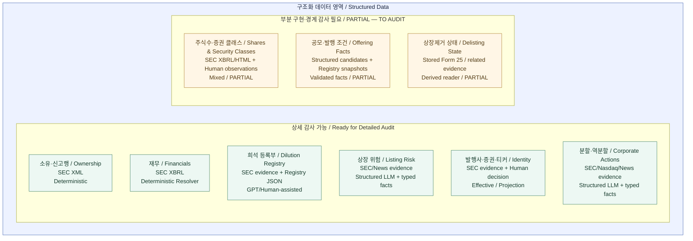

# Structured Data — 도메인 inventory

> **No inference.** 이 문서는 이전 1단계에서 확인한 도메인 목록이다. 전체 처리 흐름, 도메인 간 의존관계, 권위 source 우선순위 또는 production wiring을 확정하는 지도가 아니다.

## 쉽게 읽기

Structured Data Pipeline은 공시를 설명하는 글을 만드는 Primary Analysis와 달리, 종목 상세와 Monitor가 다시 사용할 숫자·상태·근거를 만드는 영역이다.

처리 방식은 하나가 아니다. XML/XBRL의 deterministic parser, 구조화를 위한 LLM 분석, GPT/Human-assisted 관리, Human Review를 반영한 Effective Value, 원본을 보존하는 Projection 등이 있다. **모든 도메인이 이 모든 방식을 사용하지는 않는다.** 아래 지도는 각 영역의 존재와 확인된 처리 방식을 구분할 뿐, 그 사이의 실행 순서를 표현하지 않는다.

## 검증 범위

- 기준 코드: `8cb52893a84c8de73051ae2b87427a054b9897cf`. Inventory 확인 당시 main: `7a53848a43436aceb591b12eebeaa6c64111708a` — Architecture Map 문서 기준점.
- 근거 수준: **CODE EXISTS**, 그리고 직접 호출을 확인한 일부 **WIRED — CODE**. 저장 구조는 코드·migration 선언의 존재를 뜻한다.
- **STORAGE VERIFIED / PRODUCT E2E VERIFIED 아님.** 당시 실제 DB schema 적용·row 조회나 새 ingest/LLM/E2E를 실행하지 않았다. 과거 PASS 기록을 이 inventory의 검증으로 승격하지 않는다.
- 이번 문서화에서는 새 코드·DB 조사와 도메인 상세 연결 추적을 하지 않았다.

## 도메인 지도 / Domain Inventory

**아직 전체 lifecycle로 확대 금지 / TO AUDIT:** 신규상장, 일반 merger, 전체 delisting lifecycle. 이 세 번째 상태 그룹은 조사 경계이며 도메인 박스로 추가하지 않는다.

박스는 도메인, 그룹은 상세 감사 준비 수준이다. `상세 감사 가능`은 구현 완료나 제품 E2E PASS를 뜻하지 않는다. 한국어는 빠른 이해용 설명, 영어는 기술 용어 대응이다. 화살표는 **0개**이며, 박스의 위치도 의존관계·권위·처리 순서가 아니다.

## 확인된 도메인

아래 consumer는 이전 감사에서 직접 확인한 호출자만 적었다. consumer의 코드 참조가 source부터 해당 화면까지 전체 production 경로를 검증한 것은 아니다.

| 도메인 | 목적 | 주요 Source | 현재 확인된 처리 방식 | 저장 구조 존재 여부 | Reader 존재 여부 | 확인된 Consumer | 현재 검증 수준 |
| --- | --- | --- | --- | --- | --- | --- | --- |
| Ownership | 거래·예정 매도·보유 신고행과 공시 이력 | Form 3/4/5/144, SC13 공식 XML | Deterministic parser; 신고행·정정/current-state 처리 | 있음: Form 4/144 행 저장, `sec_section16_*`, `sec_sc13_*` 선언 | `readCurrentOwnershipFacts`, Section 16 accession/current-state reader, SC13 current-state reader | Listing Matcher/Alert의 Form 4/144 입력, Section 16 Matcher, SC13 종목 조회 API·Monitor 소비 코드 | CODE EXISTS; 일부 WIRED — CODE. DB/E2E UNKNOWN |
| Financials | 매출·영업손익·순손익·영업현금흐름·현금의 기간별 재무값 | SEC CompanyFacts JSON, filing XBRL | Deterministic resolver/history | 있음: filing ledger, company facts, structured raw source; Monitor 결과의 AI 실행 envelope 사용 | `resolvePeriodicFinancials`, `resolvePeriodicFinancialHistory`, `readCurrentPeriodicFinancialFacts` | 종목 재무 API, Financial Monitor 입력·Alert 소비 코드 | CODE EXISTS; 일부 WIRED — CODE. DB/E2E UNKNOWN |
| Shares / O/S / Security Classes | 증권 클래스·시점별 주식수 근거 | SEC XBRL, prospectus HTML, structured 후보, Human observation | Deterministic 추출 + 품질 조건을 적용한 후보/Human 처리 | 있음: `share_count_history`, `issuer_common_class_universe_snapshots` 선언 | `readShareCountHistory`, class-share resolver, issuer-total aggregator | Stock Dilution 조회 코드에서 참조 | PARTIAL; CODE EXISTS 및 소비 참조 확인. source 우선순위·전체 경로 UNKNOWN |
| Dilution Registry | 증권별 발행 조건·잔여량·활동 snapshot | SEC 근거를 참조하는 Registry JSON | GPT/Human-assisted 입력 계약 + 검증·적용. GPT 생성 실행 자체는 미검증 | 있음: `dilution_instruments`, snapshots, activity, totals 및 조정 관련 선언 | `fetchStockDilution`, Registry-backed Offering reader | 종목 Dilution API, Registry-backed Offering Monitor 입력 | CODE EXISTS; 일부 WIRED — CODE. DB/E2E UNKNOWN |
| Offering Facts | 공시 accession별 공모·발행 조건 | 구조화 event 후보, 같은 accession의 Registry snapshot | 후보 검증·canonical promotion 경로와 Registry adapter가 각각 존재 | 있음: `event_offering_monitor_canonical`, Registry snapshot 선언 | `readOfferingMonitorCanonical`, `readRegistryBackedOfferingFacts` | Offering Matcher/production wiring 및 Offering Alert 소비 코드가 각각 존재 | PARTIAL; 일부 WIRED — CODE. 두 경로의 역할·권위 관계 UNKNOWN |
| Listing Risk | 상장 위험의 사건·상태·거래소·증권·날짜 | SEC/News에서 준비한 근거 | Structured LLM 분석 + validation + typed facts | 있음: `event_listing_risk_results`, `event_listing_risk_facts` 선언 | `readCurrentListingRiskFacts` | Listing Monitor Matcher/Alert | CODE EXISTS; analyzer·persistence 호출과 reader 소비 일부 WIRED — CODE. DB/E2E UNKNOWN |
| Delisting State | 특정 증권·거래소의 상장제거와 거래정지 구분 | 선택된 저장 Form 25, 관련 공시·Listing Risk 근거 | Deterministic 파생 reader; 자동 실행 결과/실패 기록 | 독립 current-state 테이블은 확인되지 않음. 실행 기록은 `source_runs.metadata.form25_delisting` | `readStoredDelistingState` | ingest/replay 자동 trigger 호출 확인; 상태 UI 소비는 미확인 | PARTIAL; 일부 WIRED — CODE. 전체 상폐 lifecycle·DB/E2E UNKNOWN |
| Issuer / Security / Ticker Identity | 관측된 identity 근거, ticker 관계와 Human 판정을 분리 | SEC cover XML/XBRL, 공식 변경 근거, Human decision | Observation, deterministic resolution, Human-effective reader, projection 구성요소 | 있음: cover observations, ticker security/evidence/resolution/human decisions, Form 25 identity evidence/decisions 선언 | cover reader, effective ticker-resolution reader, product projection, effective Form 25 identity reader | Admin, 검색·상세, Watchlist, 종목별 Alert adapter 등에서 코드 참조 확인 | CODE EXISTS; 일부 WIRED — CODE. Human decision을 읽는 Effective Value 확인. DB/E2E UNKNOWN |
| Corporate Actions — Split / Reverse Split | 분할·역분할 조건과 실행 근거 | SEC/Nasdaq/News 근거를 받는 계약 | Structured LLM + 검증된 typed facts + deterministic 실행 판정 | 있음: `event_corporate_action_results`, `event_corporate_action_facts` 선언 | `readCurrentCorporateActionFacts`, `readStockSplitExecutions` | Listing Matcher/Alert, 주식수 기준 정규화·Dilution projection 코드 참조 | CODE EXISTS; 일부 WIRED — CODE. DB/E2E UNKNOWN. 일반 merger로 확대 불가 |

### 기존 감사에서 확인한 코드 식별자

다음은 재조사 결과가 아니라 inventory 근거를 찾기 위한 기존 식별자다. 목록 순서는 실행 순서가 아니다.

| 도메인 | 기존 감사 근거 |
| --- | --- |
| Ownership | `lib/monitor/ownershipParserFacts.ts`, `lib/monitor/ownershipMonitorPersistence.ts`; `lib/sec-section16-xml/persistence.ts`, `currentState.ts`; `lib/sec-sc13-xml/currentState.ts` |
| Financials | `lib/sec-structured-data/repository.ts`, `periodicFinancialResolver.ts`, `periodicFinancialHistory.ts`; `lib/monitor/periodicFinancialMonitorSource.ts`, `financialMonitorFacts.ts` |
| Shares / O/S | `shareCountHistory.ts`, `classShareCountResolver.ts`, `issuerCommonClassUniverse.ts`, `issuerTotalCommonSharesAggregator.ts`, `humanVerifiedShareCountObservation.ts` |
| Dilution Registry | `lib/dilution-registry/applyContract.ts`, `applyServer.ts`, `stockDilutionServer.ts` |
| Offering Facts | `offeringMonitorCanonicalPersistence.ts`, `offeringMonitorMatcher.ts`; `lib/monitor/registryBackedOfferingFacts.ts`, `offeringMonitorAlertConsumer.ts` |
| Listing Risk | `lib/ai/listingRiskDomainAnalyzerPreview.ts`; `lib/monitor/genericMonitorChildRuntime.ts`, `listingRiskPersistence.ts` |
| Delisting State | `lib/sec-delisting-state/reader.ts`, `automaticTrigger.ts`; `lib/secIngest.ts` |
| Identity | `lib/sec-cover-observations/persistence.ts`; `lib/sec-ticker-resolution/persistence.ts`, `humanReview.ts`, `productProjection.ts`; `lib/sec-form25-identity/persistence.ts` |
| Corporate Actions | `lib/ai/corporateActionCanonicalAnalyzerPreview.ts`; `lib/monitor/corporateActionPersistence.ts`, `reverseSplitExecution.ts` |

## 용어와 분류의 경계

- **Extracted Fact:** parser/LLM이 추출한 값. 원문 또는 최종 신뢰값과 동일하다고 간주하지 않는다.
- **Canonical Fact:** `facts` 테이블이나 `canonical` 파일명만으로 확정하지 않는다. 도메인별 품질·출처 조건은 상세 감사 전 **Canonical candidate / TO AUDIT**로 취급한다.
- **Effective Value:** `current` reader라는 이름만으로 확정하지 않는다. Human decision을 실제로 읽는 ticker resolution/Form 25 identity는 확인된 범위에서 Effective Value라고 부른다. 다른 영역의 Human 반영은 **Effective candidate / TO AUDIT**다.
- **Projection:** 원본을 바꾸지 않는 ticker projection은 확인된 구성요소다. 다른 파생 계산을 모두 같은 의미로 분류하지 않으며, 필요하면 **Projection candidate / TO AUDIT**로 남긴다.
- Financial Monitor가 `ai_runs` / `ai_outputs` envelope를 사용한다고 그 deterministic resolver를 LLM 분석으로 분류하지 않는다.
- Form 25 Analysis Human Correction은 기존 분석을 보존하며 effective 값을 제공하는 공통 검토 장치로 확인됐다. 이를 별도의 신규 도메인 박스로 중복 계산하지 않는다. 다른 도메인으로의 전파는 UNKNOWN이다.
- Primary 설명문과 XML/XBRL 신고값은 같은 공시를 사용해도 별개일 수 있다. 이 문서로 둘의 실제 연결을 확정하지 않는다.

## 의도적으로 그리지 않은 관계

Ownership → Monitor, Financials → Stock Detail, Dilution → Offering, Listing Risk → Delisting, Split → O/S → Dilution, Identity → 모든 도메인, Primary Analysis ↔ Structured Data의 연결은 그리지 않았다. 개별 소비 참조와 전체 데이터 흐름을 구분하며, 상세 감사에서 각각 근거를 확인한다.

## UNKNOWN / TO AUDIT

- 실제 DB schema 적용 여부와 저장 row 상태.
- source → persistence → reader의 전체 production 연결 및 운영 활성화.
- 도메인 간 권위 source 우선순위, 동일 필드의 충돌 처리.
- Human override의 각 consumer·다른 도메인 전파.
- Stock Detail / Monitor의 실제 제품 E2E.
- Shares/O/S의 여러 source 품질·권위 경계, Offering의 두 저장/소비 경로 관계.
- **신규상장 / 일반 merger / 전체 delisting lifecycle.** Prospectus 주식수 근거, 분할 판정 또는 특정 Form 25 reader의 존재로 전체 lifecycle 구현을 주장하지 않는다.

## 다음 상세 감사 순서

1. Ownership
2. Financials
3. Shares / O/S
4. Dilution Registry + Offering
5. Listing Risk + Delisting
6. Corporate Actions
7. Identity

이 순서는 **조사 순서**일 뿐 데이터 흐름·의존관계·source 우선순위가 아니다.
