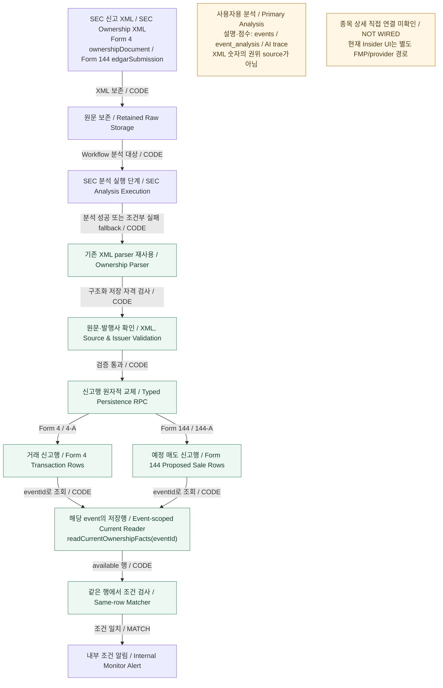

# Form 4/144 Structured Ownership — Verified As-Is

> **No inference.** 범위는 Form 4 / 4-A와 Form 144 / 144-A다. 코드의 정규화 표기는 `4/A`, `144/A`다. 이 문서는 직전 Ownership 상세 감사 1단계-A 결과만 기록한다. 새 코드·DB 조사나 실행으로 검증 범위를 넓히지 않았다.

## 1. 쉽게 읽기

Form 4/144의 Monitor용 숫자는 AI가 만든 투자자용 설명에서 가져오지 않는다. 기존 parser가 SEC Ownership XML의 신고값을 읽고, source와 issuer 검증을 거쳐 구조화 행으로 저장한다.

하지만 실행 구조는 완전히 독립적인 별도 ingest pipeline이 아니다. 원문 저장 후 **SEC 분석 실행 과정에서 structured persistence가 호출**된다. Primary 분석이 실패해도 Ownership parser input이 있고 dry-run이 아닌 경우에는 XML 신고행만 저장하는 fallback 경로가 있다. XML 검증까지 실패한 경우나 parser input 준비 전 실패도 항상 저장되는 것은 아니다.

**값의 권위 source는 분리되어 있지만 실행·저장 실패 경계는 완전히 독립적이지 않다.**

## 2. 검증 수준

| 수준 | 이번 문서의 범위 |
| --- | --- |
| **VERIFIED CODE / WIRED — CODE** | 실제 함수·호출·저장 계약·reader·consumer 코드 연결 확인 |
| **DB STRUCTURE VERIFIED** | shared-local 테이블, PK/FK, 교체 RPC 존재와 구조 확인 |
| **UNKNOWN — 실제 저장 경로** | Form 4/144 저장 표본이 없어 source → stored row → reader 대조 미검증 |
| **UNKNOWN — 제품 실행** | PRODUCT PATH VERIFIED 및 E2E VERIFIED 아님 |

**STORAGE VERIFIED로 표시하지 않는다.** DB 구조의 존재는 실제 공시가 해당 경로로 저장됐다는 증거가 아니다. 그림의 화살표도 코드 연결을 뜻하며 production 활성화나 제품 E2E 성공을 뜻하지 않는다.

## 3. Form 4/144 Structured Ownership As-Is

박스는 처리 단계, 화살표는 감사에서 확인한 코드 연결이다. 한국어는 빠른 이해용, 영어는 기술 용어 대응이다. source 선택·실패 조건의 세부 사항은 아래 표를 참조한다.

- 그림의 parser는 **typed row를 만들 때 기존 parser를 재사용하는 경계**다. Primary 입력 준비에서도 parser 일부를 공유한다. 그림은 parser가 전체 실행에서 한 번만 호출된다는 뜻이 아니다.
- `current`는 회사 전체 최신 Ownership 상태가 아니라 **특정 event에 현재 저장된 typed rows**다.
- Primary와 Stock Detail 박스는 경계 설명용이며 데이터 전달 화살표가 없다. 특히 **Primary LLM → Ownership canonical 숫자**, **typed rows → Stock Detail** 연결은 그리지 않았다.
- Internal Monitor Alert는 Primary Score Alert와 별도다. 외부 Telegram/email 발송 성공은 UNKNOWN이다.

## 4. Primary와 Structured Ownership의 관계

| 구분 | Primary Analysis | Structured Ownership |
| --- | --- | --- |
| 목적 | 투자자용 설명·점수 | Monitor가 평가할 신고행·직접값 |
| 입력·권위 | parser가 준비한 신고·footnote·source evidence 등을 담은 분석용 JSON | retained SEC XML을 기존 parser로 다시 읽고 검증한 값 |
| 저장 | `events`, `event_analysis`, AI run/output trace | `event_form4_transactions`, `event_form144_proposed_sales` |
| 공유하는 것 | retained XML 및 기존 Ownership parser 일부 | 동일한 원문·parser를 재사용 |
| 공유하지 않는 의미 | AI 해석·점수를 작성 | LLM의 `ownership_monitor_facts`를 canonical 숫자로 사용하지 않음 |

분석 성공 경로는 XML 검증과 typed persistence를 필수로 호출한다. 이 검증·저장 실패가 분석 결과 저장 처리를 중단할 수 있다. 분석 실패 경로는 Ownership parser input 존재와 비 dry-run 조건을 만족하면 `saveOwnershipParserDetailsEvent`를 시도하고, 성공한 경우 Ownership Monitor 평가도 호출한다.

원문 ingest만으로 Form 4/144 typed persistence가 항상 완료되지는 않는다. 모든 Primary 실패를 독립적으로 복구하는 경로라고도 일반화하지 않는다.

## 5. Form 4 facts

| 항목 | Parser 제공 | 두 Monitor typed table 기준 저장·승격 |
| --- | --- | --- |
| Transaction rows | 비파생·파생 거래행 구분 | Form 4 거래행으로 저장, 상계·합산하지 않음 |
| Security | security title, derivative 구분, underlying 정보 | title·transaction kind 저장. 영구 security identity 확정 아님 |
| Dates | 거래일·deemed execution date | 유효한 날짜 저장 |
| Code / acquired-disposed | transaction code, A/D | 저장. 경제적 매매 방향은 `unknown` |
| Quantity / price | 수량·단가, 원문 표현과 상태 | 확인 가능한 비음수 숫자만 exact/available로 저장 |
| Post-transaction shares | 거래 후 보유주식과 원문 상태 | 저장. 현재 보유량으로 합산하지 않음 |
| Direct / indirect | D/I, nature of ownership | 저장 |
| Reporting owner | CIK·이름·역할·복수 보고자 | 이름·역할 집합 저장. 단일 보고자일 때 일부 역할값 저장. 보고자 CIK는 독립 typed 필드로 저장하지 않음 |
| Footnote evidence | 본문·ID·필드별 연결 | ID·필드별 연결과 일부 행 excerpt 저장. 전체 본문은 retained XML에 존재 |
| Holdings | 별도 holding rows 제공 | **두 Monitor typed table에 미저장** |
| Exercise / conversion / underlying | 행사·전환 가격, 기초증권명·수량 등 제공 | 해당 거래행 테이블의 독립 필드로 미저장 |
| Transaction value | parser에 계산값 존재 | **미사용: null / unavailable** |
| 10b5-1 | filing/trading-plan 관련 추출 존재 | **row-level `is_10b5_1`은 null** |

issuer ticker와 개별 transaction/holding의 security title·underlying security를 동일한 identity로 간주하지 않는다.

## 6. Form 144 facts

| 항목 | 현재 저장 의미 |
| --- | --- |
| Proposed sale row | XML `securitiesInformation` 하나당 예정 매도행 |
| Security / exchange | 증권명·거래소 |
| Quantity | 예정 매도 수량 |
| Aggregate market value | 신고된 aggregate market value. 실제 체결가격·완료 매도대금으로 변경하지 않음 |
| Approximate sale date | 예정 매도 날짜. 완료 거래일 아님 |
| Outstanding shares | 신고된 outstanding 수량 |
| Seller | seller/account person 이름 |
| Execution status | provenance의 **`proposed_not_executed`** |
| Proposed sale percent | parser 계산값을 승격하지 않고 null / unavailable |

issuer relationship, broker, 취득 내역, 과거 매도, plan adoption/instruction dates 등은 parser에 존재하지만 예정 매도 테이블의 독립 필드로는 저장하지 않는다. **예정 매도와 실제 매도를 합치지 않는다.**

## 7. Canonical eligibility

| 조건 | 확인된 제품 경계 |
| --- | --- |
| Verified Ownership XML | `raw_items.raw_payload.ownership_source_text`의 XML이 선택되어야 함. Form 4 root는 `ownershipDocument`, Form 144는 `edgarSubmission` |
| Accession | raw identity·metadata·SEC Archives URL의 accession 일치 검사 |
| Issuer | XML issuer CIK와 target issuer CIK 일치 필수. reporting-owner CIK와 구분 |
| Ticker | XML ticker 우선, 없으면 raw target ticker. ticker들이 충돌하면 거부. 모든 ticker가 XML에 직접 기재됐다는 뜻은 아님 |
| Missing / truncated | 거부. 수집 시 XML 보존 한도는 500,000자 |
| Malformed | root·종료 태그·source 상태 검사에 걸리면 거부. **완전한 XML/XSD validation은 아님** |
| HTML/text fallback | 공통 parser의 제한적 추출은 가능하지만 이 typed persistence에서는 거부 |
| LLM-only input | canonical 입력으로 거부 |

원본 URL, accession, parser version, source 선택 상태, issuer 대조 결과를 provenance에 기록한다. DB RPC 자체가 XML 진위를 다시 검증하는 것은 아니다. 제품 TypeScript 경계와 reader 검증을 구분해야 한다.

## 8. Persistence 의미

- Form 4: `event_form4_transactions`, PK **`(event_id, transaction_index)`**.
- Form 144: `event_form144_proposed_sales`, PK **`(event_id, proposed_sale_index)`**.
- 두 테이블 모두 `events(id)` FK를 가진다. event는 accession 기반 dedupe를 사용한다.
- `replace_event_ownership_facts`는 해당 event의 기존 행을 지우고 새 행을 넣는 **원자적 교체**다. 삽입 실패 시 rollback된다.
- replay는 행을 누적하지 않는다. 그러나 **typed rows 자체는 append-only가 아니다.**
- 다른 amendment accession은 별도 event로 남는다. reader가 원공시와 정정본을 자동 통합하거나 superseded 처리하지 않는다.
- 행 provenance에 accession·source URL·parser version·issuer 대조·행 index가 있다. footnote ID와 필드별 연결을 보존하며, 행 evidence는 일부 excerpt다.

## 9. Reader의 current 의미

`readCurrentOwnershipFacts(eventId)`는 **특정 event에 현재 저장된 검증 가능한 행**을 읽는다.

- 회사/issuer 전체 latest filing이나 current holdings를 구하지 않는다.
- amendment supersession이나 reporting-owner 수량 aggregation을 수행하지 않는다.
- Form 4/A·144/A를 해당 family로 읽으며, amendment라는 이유만으로 제외하지 않는다.
- event/form·행 순번·accession·parser version·provenance·issuer·값 상태를 검사한다.
- 잘못된 행 하나가 있으면 그 행만 제외하지 않고 **전체 `not_ready`**를 반환한다.
- `0`은 exact/available, 누락·텍스트 값은 null/unknown/unavailable로 구분한다.
- 원문 표현과 추출 상태는 저장된 audit 정보로 남지만, 모든 미확정 상태를 독립된 수치로 만들지는 않는다.
- 테이블별 조회 한도는 1,000행이다. holdings-only 등 거래행이 없으면 `ownership_rows_missing`이다.
- reader는 raw XML을 다시 파싱하지 않고 저장된 provenance를 검사한다.

## 10. Consumers와 NOT WIRED 경계

**VERIFIED CODE:** typed rows → 공식 reader → 동일 행 Matcher → 내부 Monitor Alert.

`listingMonitorMatcher`와 `listingMonitorAlertConsumer`가 reader를 사용한다. 여러 Ownership 조건은 **동일 신고행에서 함께 충족**해야 한다. 복수 보고자를 특정 거래행에 귀속할 수 없으면 보고자 역할과 거래조건의 결합 등은 ineligible이다. 누락·품질 미확정 값도 unavailable/ineligible 처리한다.

MATCH 결과는 `user_alert_deliveries`에 내부 Alert로 저장하며 중복 기준은 `listing_monitor_id + alert_event_id`다. 현재가 조건이 필요한 경우 별도 current-price adapter를 사용한다. Primary Score Alert와 외부 발송 성공으로 확대하지 않는다.

**Stock Detail 직접 연결: NOT WIRED — 이번 감사에서 typed-row 직접 consumer 연결 미확인.** 현재 종목 상세 Insider 통계·거래 목록은 `StockRadarWatchlistV2`의 `/api/market/fmp/fundamentals` → `fetchStockFundamentals` → provider cache/FMP 경로다. Ownership 관련 event 목록은 별도로 표시한다. 이를 Form 4/144 typed-row 소비라고 표시하지 않는다. 해당 GET은 cache 쓰기를 유발할 수 있어 감사에서 실행하지 않았다.

## 11. Verification evidence

기준 main: **`f0d3a92e5eef025e1cdf8200045e2a34aeef7a85`**.

| shared-local 읽기 전용 확인 | 결과 |
| --- | --- |
| Form 4/144 관련 raw | 0건 |
| 해당 form의 events | 0건 |
| `event_form4_transactions` | 0행 |
| `event_form144_proposed_sales` | 0행 |
| Schema / PK / FK / RPC | 존재·구조 확인 |

직전 감사는 `BEGIN READ ONLY`로 위 구조와 건수를 확인했다. **CODE + DB STRUCTURE까지만 확인했으며 실제 표본의 STORAGE VERIFIED, PRODUCT PATH VERIFIED, E2E VERIFIED는 없다.** 이번 문서화의 Mermaid 렌더링은 문서 표시 검증일 뿐 제품 E2E가 아니다.

기존 감사에서 확인한 근거 위치:

| 역할 | 코드 근거 |
| --- | --- |
| XML 수집·원문 보존 | `lib/sources/sec/parser.ts`: `fetchSecEdgarRawItems`, `buildOwnershipRawSource`; `lib/secStores/rawStore.ts`: `saveSecRawItem` |
| Workflow / 분석 중 저장 호출 | `workflows/source-ingest.ts`; `lib/secFilingAnalysisIngest.ts`: `runSecFilingAnalysisIngest` |
| 기존 parser / Primary 입력 | `lib/sources/sec/forms/ownership/parser.ts`, `adapter.ts`, `analysisPrompt.ts`; `lib/ai/secOwnershipAnalysisAdapter.ts` |
| Typed eligibility / persistence | `lib/monitor/ownershipParserFacts.ts`: `buildOwnershipParserFactRows`; `lib/monitor/persistence.ts`: `persistOwnershipAnalysisFacts`; `lib/secStores/eventStore.ts`: `saveAnalyzedSecFilingEvent`, `saveOwnershipParserDetailsEvent` |
| Event-scoped reader | `lib/monitor/ownershipMonitorPersistence.ts`: `readCurrentOwnershipFacts` |
| Monitor 소비 | `lib/listingMonitorMatcher.ts`; `lib/monitor/listingMonitorAlertConsumer.ts` |
| 별도 Stock Detail 경로 | `components/watchlist-v2/StockRadarWatchlistV2.tsx`; `lib/watchlist/stockFundamentalsServer.ts` |

## 12. UNKNOWN / TO AUDIT

- 실제 filing의 source → stored row → reader → consumer product path.
- amendment를 반영한 통합 current state.
- Stock Detail의 Form 4/144 typed-row 연결. 현재는 NOT WIRED 경계로 표시한다.
- holdings·underlying security·전체 footnotes의 별도 저장/소비.
- **1,000행 초과** 공시의 완전한 조회.
- malformed XML 전체 경계와 완전한 XML/XSD 수준 유효성.
- production scheduler 활성화와 외부 Telegram/email delivery.

이 문서는 위 연결의 추가 구현, provider 제거 또는 amendment 통합 방식을 제안하지 않는다.
