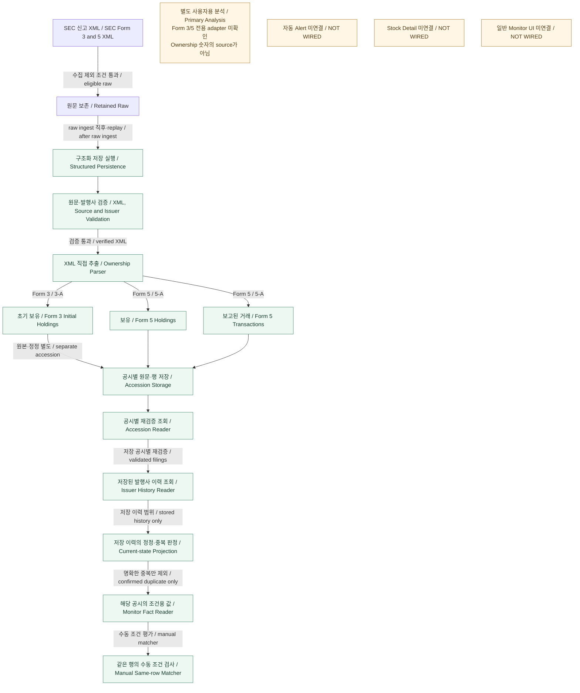

# Ownership — Form 3/5 Structured Data

> **VERIFIED AS-IS — CODE EXISTS / WIRED + DB STRUCTURE VERIFIED**
> 기준 main: `f0d3a92e5eef025e1cdf8200045e2a34aeef7a85`.
> Ownership 상세 감사 2단계-A 결과만 문서화했다. 실제 저장 표본은 0건이다. **STORAGE VERIFIED / PRODUCT PATH VERIFIED / E2E VERIFIED가 아니다.**

## 1. 쉬운 설명

Form 3/5의 Ownership 숫자는 AI 설명에서 가져오지 않는다. SEC XML에서 보유·거래 내용과 근거를 직접 읽어 저장한다. Form 3는 초기 보유 중심이고, Form 5는 보유와 보고된 거래를 분리해 보존한다. 정정 공시는 원본을 덮어쓰지 않고 다른 accession의 이력으로 남는다.

Form 4/144와 달리 Form 3/5 structured persistence는 **raw ingest 직후** 호출된다. Primary LLM이 없어도 저장할 수 있다. 현재 consumer 연결은 수동 Matcher까지이며, 일반 Monitor UI·자동 Monitor Alert·Stock Detail 연결은 없다.

## 2. Form 3/5 Structured Ownership As-Is

아래 연결은 **CODE/WIRED** 수준이다. DB 구조의 존재는 저장 실행이나 운영 활성화의 증거가 아니다.

박스는 처리 역할, 화살표는 확인된 데이터 전달·구성 관계다. 한국어는 빠른 이해를 위한 설명이고 영어는 개발 용어 대응이다. 세부 조건은 아래 표와 근거를 따른다.

검증과 parser는 별도 서비스가 아니라 persistence 내부의 검증·추출 역할을 나눠 그렸다. Reader 부분도 함수들의 일렬 호출 스택을 뜻하지 않는다. `readSection16IssuerCurrentState`가 issuer의 저장 accession을 페이지 조회하고 각 공시에 `readSection16FilingByAccession`을 호출한 뒤 projection을 만든다. 별도 제한형 `readSection16FilingHistoryByIssuer`를 호출한다는 의미는 아니다. Monitor Fact Reader는 대상 accession과 issuer current-state를 모두 읽는다.

정기 수집 설정에는 Form 3/5가 없다. 명시적으로 accession/form을 지정한 raw ingest에 저장 연결이 존재한다는 것이며, 자동 운영 수집 완료를 뜻하지 않는다. Raw 저장 전 기존 수집 제외 조건도 적용된다.

## 3. Primary Analysis와의 경계

| 영역 | 확인된 실행·권위 source |
| --- | --- |
| Form 3/5 Structured Ownership | raw ingest → XML persistence. SEC XML 직접값이며 Primary LLM 성공을 저장 조건으로 요구하지 않음 |
| Primary Analysis | 사용자용 설명·점수. Form 3/5 전용 Primary adapter는 확인되지 않음. 공통 runner에 generic fallback은 있으나 Form 3/5 제품 실행은 UNKNOWN |

`Primary LLM → Ownership 숫자` 연결은 없다. XML parser는 수집 helper, persistence, readback 재검증에서 재사용된다. Persistence 실패는 별도로 기록되며 raw ingest와 Primary 분석의 성공 여부로 대체하지 않는다.

## 4. Form 3 — Initial Holdings

| 데이터 | 보존 범위 |
| --- | --- |
| Non-derivative / derivative holdings | 별도 row kind |
| Security | security title, 파생증권의 underlying security |
| Quantity / value | 보유수량·가액의 XML 값 |
| Ownership | direct/indirect, ownership nature |
| Derivative | conversion/exercise price, exercise date, expiration date, underlying 수량·가액 |
| Reporting owners | CIK·이름·관계·주소를 배열로 보존 |
| Evidence | 필드 XML path, raw value, footnote ID·본문, 원문 XML |

초기 보유를 거래로 변환하지 않는다. Form 3 XML에 transaction row가 있으면 `form3_transaction_rows` 오류로 거부한다. 원본이 명시적으로 무보유였고 정정본에 보유가 추가된 경우에도 `added_disclosed_holding`이며 취득·매수 결론이 아니다.

## 5. Form 5 — Holdings와 Transactions

| 데이터 | 보존 범위 |
| --- | --- |
| Transactions / holdings | 별도 배열·저장 테이블 |
| 거래 식별 | transaction date, deemed execution date, transaction code, row의 form type, timeliness |
| 수량·가격 | quantity, price per share, acquired/disposed |
| 거래 후 보유 | post-transaction shares/value, direct/indirect, ownership nature |
| 파생증권 | conversion/exercise price, exercise/expiration dates, underlying security·수량·가액 |
| 근거 | footnotes와 XML path·raw value |
| 보고 metadata | period of report, filing date, accepted time, original submission date, 보고 관련 flags |

연간 보고기간이나 filing date를 transaction date로 바꾸지 않는다. `transactionTotalValue`는 구현상 파생 거래의 해당 XML 값을 읽으며 수량×가격으로 생성하지 않는다.

## 6. Amendment / Lineage

- Original과 amendment는 별도 accession으로 저장한다. 원본 row를 overwrite하지 않는다.
- Amendment에서 빠진 row를 삭제로 해석하지 않는다. Holdings는 공시별 snapshot으로 모두 보존한다.
- 원본 후보는 같은 form family의 비정정 공시에서 찾는다. `dateOfOriginalSubmission`과 원본 filing date, issuer CIK, reporting-owner CIK 집합, 제출 순서, 후보의 유일성을 확인한다.
- Filing-level lineage와 security row matching은 별개다. 공시 lineage가 연결돼도 security identity는 unresolved이거나 불일치 진단이 남을 수 있다.
- 명확한 footnote와 유일한 보유 row 대응이 있을 때만 holding correction을 별도로 계산한다. 계산 결과로 원본 snapshot을 덮어쓰지 않는다.

## 7. Duplicate Transaction

Date + quantity만으로 duplicate를 판단하지 않는다.

1. Original/amendment lineage가 먼저 확인돼야 한다.
2. Row index와 최상위 XML path를 제외한 transaction payload 및 연결된 footnotes를 비교한다. Security, code, 날짜, 수량, 가격, 취득/처분, 보유방식, 파생 조건 등이 포함된다.
3. 원본·정정본 양쪽에서 unique row match가 필요하다.
4. 원본과 특정 거래를 지칭하는 명시적 재보고·동일 거래 근거가 필요하다.
5. 불확실·부정·충돌·복수 대응이면 보존한다.

Confirmed duplicate도 DB row를 삭제하지 않는다. Projection에서 `excluded_confirmed_duplicate`로 판정하고 Monitor Fact Reader의 거래 대상에서 제외한다. 미확정 반복은 남으므로 Matcher의 개수는 고유 거래 수가 아닌 **공시 row 수**다.

**실제 SEC duplicate positive Product E2E는 미검증이다. 확인된 양성 테스트는 synthetic amendment다.**

## 8. Persistence

| 저장 구조 | 역할·row identity |
| --- | --- |
| `raw_items` | accession 기반 raw 및 retained XML; 기존 raw upsert 정책 |
| `sec_section16_filings` | accession PK, raw UUID unique/FK; XML·source SHA·parser payload·provenance |
| `sec_section16_reporting_owners` | accession + reporting owner index |
| `sec_section16_transactions` | accession + row ordinal; accession + row kind + row index unique |
| `sec_section16_holdings` | accession + row ordinal; accession + row kind + row index unique |
| `sec_section16_footnotes` | accession + index; accession + footnote ID unique |
| `sec_section16_signatures` | accession + signature index |

`persist_sec_section16_filing`은 accession 잠금을 사용하는 원자적 **insert-or-verify**다. 저장된 raw source를 재확인하고, 동일 원문·payload·child rows replay는 `replayed`를 반환한다. 내용 충돌은 거부하며 정정 accession은 별도로 저장한다.

Lineage/current-state는 reader에서 계산한다. 별도 결과 테이블을 가정하지 않는다. Canonical filing/child 저장 계약과 달리 **raw 전체가 append-only인 것은 아니다.** 기존 raw upsert와 persistence 상태 metadata 갱신이 존재한다.

### Source eligibility

공식 SEC Archives URL·accession, `ownership_xml`, document type, XML issuer CIK와 수집 metadata의 issuer CIK, 원문 길이·제공된 SHA를 확인한다. Canonical 저장 시 stored raw와 호출 입력 및 계산한 SHA도 대조한다. HTML/text fallback, malformed/truncated XML은 거부한다. XML 문법·구조 검사이며 완전한 XSD validation은 아니다. Namespace XML은 현재 지원하지 않는다.

## 9. Reader와 current-state의 의미

| Reader | 의미 |
| --- | --- |
| `readSection16FilingByAccession` | 한 accession의 XML·SHA·parser payload·child rows를 재대조 |
| `readSection16FilingHistoryByIssuer` | issuer 저장 이력의 제한 조회: 기본 50, 최대 100건 |
| `readSection16IssuerCurrentState` | 저장 이력을 페이지 조회하고 lineage·중복·보유 교정 projection 계산 |
| `readSection16MonitorFacts` | 특정 공시의 holdings와 confirmed duplicate를 제외한 transactions 제공 |

**`readSection16IssuerCurrentState` = 저장된 filing history 범위에서 계산한 projection.**

이는 SEC 전체 완전한 이력, 회사 전체 최신 잔고, 여러 owner 자동 합산, 모든 transaction의 owner attribution이 아니다. Scope는 `complete_stored_history_not_sec_global`이다.

명시적인 `0`과 `missing / empty / footnote_only`를 구분한다. 이력 누락·검증 실패·조회 한도 문제는 unavailable/not_ready로 처리한다. Monitor Fact Reader는 correction 정보가 존재하더라도 해당 공시의 원래 holdings snapshot을 읽는다.

## 10. Consumers

| Consumer | 상태·계약 |
| --- | --- |
| Structured rows → official readers → Monitor Fact Reader → Manual Same-row Matcher | CODE/WIRED. 동일 row에서 조건 검사; holdings/transactions 혼합 조건은 거부 |
| 수동 조건 저장 | 기존 `listing_monitors` 재사용, `is_active=false` 강제, `manual_only_no_alerts` |
| 일반 Monitor UI | NOT WIRED |
| Automatic internal Monitor Alert | NOT WIRED |
| Stock Detail | 해당 structured reader 직접 연결 NOT WIRED |
| Public Ownership API | 해당 reader 연결 NOT WIRED |

확인된 Matcher 호출자는 격리 검증 스크립트다. 공시별 수동 평가 구현을 사용자용 자동 Monitor 운영 완료로 표현하지 않는다. Primary Score Alert는 별도 시스템이다.

## 11. Form 4/144와의 차이

| 항목 | Form 4/144 | Form 3/5 |
| --- | --- | --- |
| Structured 저장 실행 | SEC 분석 실행 단계에 연결 | raw ingest 직후 별도 호출 |
| 저장 단위 | event-scoped typed rows | accession/history 기반 |
| 정정·current 의미 | 해당 event의 현재 저장행 | 저장 이력의 lineage/current-state projection |
| Consumer | official reader → Matcher → automatic internal Monitor Alert, CODE 연결 | 현재 수동 Matcher까지 |

같은 Ownership이어도 단일 실행 pipeline이 아니다. Form 4/144의 상세 범위와 미검증 사항은 [기존 문서](03-ownership-form4-144.md)를 따른다.

## 12. Verification Evidence

기준 main: `f0d3a92e5eef025e1cdf8200045e2a34aeef7a85`. 아래는 직전 감사 결과이며 이번 문서 작성 중 재조회·재실행하지 않았다.

| 검증 항목 | 직전 감사 결과 | 수준 |
| --- | --- | --- |
| XML 저장·replay 호출, reader, 수동 Matcher | 코드 연결 확인 | CODE EXISTS / WIRED |
| shared-local 테이블 6개, PK/FK, persistence/state RPC | 존재 및 저장 RPC의 잠금·충돌 거부·replay 분기 확인 | DB STRUCTURE VERIFIED |
| Form 3/5 raw / filings / child rows | 모두 0건 | 실제 저장 표본 없음 |
| 해당 raw와 연결된 events / 수동 조건 저장 | 0건 | 제품 실행 근거 없음 |
| 실제 공시 → 저장 → reader → consumer | 대조하지 못함 | UNKNOWN |

로컬 fixture는 동일한 증거 수준이 아니다. 원본 counterpart 2건의 manifest는 공식 다운로드 바이트로 기록돼 있다. 기존 3건의 manifest는 전사 XML이며 live byte identity 미검증이라고 명시한다. 이 fixture 기록이나 과거 테스트 이름을 STORAGE·PRODUCT PATH·E2E VERIFIED로 승격하지 않는다.

### 확인된 코드 근거

- [`lib/secIngest.ts`](../../../lib/secIngest.ts): 신규 raw 저장·기존 raw replay 뒤 `persistSection16XmlAfterRawSave` 호출.
- [`section16Xml/parser.ts`](../../../lib/sources/sec/forms/section16Xml/parser.ts), [`collection.ts`](../../../lib/sources/sec/forms/section16Xml/collection.ts): XML 검증·필드 추출과 명시적 수집 helper.
- [`canonical.ts`](../../../lib/sec-section16-xml/canonical.ts), [`persistence.ts`](../../../lib/sec-section16-xml/persistence.ts): canonical payload·insert-or-verify·readback.
- [`lineage.ts`](../../../lib/sec-section16-xml/lineage.ts), [`currentState.ts`](../../../lib/sec-section16-xml/currentState.ts): 정정·거래 중복·저장 이력 projection.
- [`section16MonitorFacts.ts`](../../../lib/monitor/section16MonitorFacts.ts), [`section16MonitorMatcher.ts`](../../../lib/section16MonitorMatcher.ts), [`section16MonitorPersistence.ts`](../../../lib/monitor/section16MonitorPersistence.ts): 수동 조건용 값·Matcher·비활성 조건 저장.
- [`20260912012348 migration`](../../../supabase/migrations/20260912012348_sec_section16_xml_canonical_persistence.sql): accession 및 child PK/FK, 원자적 저장 계약.

## 13. UNKNOWN / TO AUDIT

- 실제 Form 3/5 product ingest·replay·reader·consumer 실행.
- 실제 duplicate positive SEC 사례.
- Multi-owner 실제 저장·제품 표본.
- 저장되지 않은 historical filing 누락 영향.
- 회사 전체 최신 잔고와 owner별 거래 귀속.
- Full XSD validation 및 전체 malformed XML 경계.
- 조회·저장 한도 초과 실제 사례.
- 운영 수집 활성화. 현재 정기 수집 목록에는 Form 3/5가 없다.

Stock Detail·일반 Monitor UI·자동 Alert 연결과 전체 최신 잔고 계산을 이미 구현된 기능으로 추가하지 않는다. 이 문서는 개선안이나 신규 연결 설계가 아니다.
