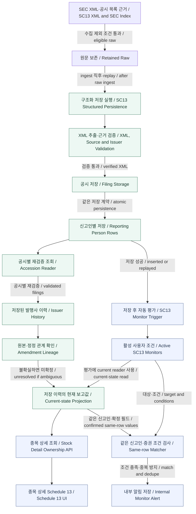

# SC13 Structured Ownership — Verified As-Is

> **No inference:** Ownership 상세 감사 3단계-A에서 확인한 사실만 기록한다. 기준 main은 `f0d3a92e5eef025e1cdf8200045e2a34aeef7a85`다. 검증 수준은 **CODE EXISTS / WIRED + DB STRUCTURE VERIFIED**이며, 실제 SC13 저장 표본은 0건이다. **STORAGE VERIFIED / PRODUCT PATH VERIFIED / E2E VERIFIED가 아니다.** 이 문서 작성 중 새 코드·DB 조사나 ingest/LLM/E2E를 실행하지 않았다.

## 1. 쉬운 설명

SC 13D / 13D-A / 13G / 13G-A의 지분율과 보유주식수는 AI 설명에서 가져오지 않는다. SEC XML에서 신고인(reporting person)별로 직접 읽어 저장한다. 여러 공동 신고인이 같은 주식을 보고할 수 있으므로 각자의 숫자를 합산하지 않는다.

원본과 정정 공시는 별도 공시로 보존한다. 저장된 이력의 발행사·증권·신고인 관계와 정정 계보가 충분히 확실할 때만 현재 보고값 projection을 계산한다. 이는 실시간 보유량이 아니라 **저장된 SEC 공시 이력에서 확인 가능한 현재 보고값**이다.

현재 코드에는 종목 상세 Schedule 13 영역과 자동 내부 Monitor Alert까지 연결이 있다. 실제 저장 데이터로 그 전체 경로를 검증한 것은 아니다.

## 2. SC13 Structured Ownership 현재 구조

**아래 화살표의 근거 수준은 CODE/WIRED다.** 저장 노드의 테이블·제약·RPC 존재는 DB STRUCTURE VERIFIED이며, 실제 row 저장이나 운영 활성화를 뜻하지 않는다. 그림은 확인된 처리·소비 관계를 요약하며 함수 내부의 모든 호출 순서를 표현하지 않는다.

범례: 박스는 처리·저장·조회 단계, 화살표 라벨은 감사에서 확인된 주요 조건이다. 한국어는 쉬운 설명, 영어는 개발 용어 대응이며 세부 조건은 본문을 따른다.

- **Current-state:** 저장된 이력 범위의 projection이다. SEC 전체 이력이나 실시간 잔고가 아니다. reader 바깥 상태가 `available`이어도 개별 position은 unresolved일 수 있다.
- **NOT WIRED:** 일반 Monitor UI의 SC13 조건 생성 연결. 위 그림은 해당 UI까지 연결하지 않는다.
- **UNKNOWN:** production scheduler 활성화, 외부 Telegram/email delivery 및 현재 제품 E2E.
- **별도 시스템:** Primary Score Alert. 위 Internal Monitor Alert와 같은 경로로 합치지 않는다.

## 3. Source / Security Identity

| 항목 | 확인된 역할 |
| --- | --- |
| Accession | 공시 저장 identity. 입력 accession·SEC source URL과 대조 |
| Issuer CIK | XML issuer와 SEC index subject company를 대조 |
| Filed-by CIK | XML header filer와 SEC index filed-by를 대조. issuer와 혼동하지 않음 |
| Reporting person CIK | 신고인별 identity와 정정 계보 판단에 사용 |
| Security class / CUSIP | 정규화한 class·CUSIP 집합을 증권 구분과 lineage matching에 사용 |
| Ticker | amendment/history identity key가 아님. 종목 상세 진입 시 issuer를 찾는 조회 문맥과 구분 |

Structured holding source는 보존된 SEC Schedule 13 XML이다. HTML/text fallback 또는 LLM-only 숫자는 이 저장 경로에 허용하지 않는다. 잘린 source, malformed XML, namespace/schema version 불일치, accession/issuer 근거 충돌 등을 거부한다. 이는 선별된 구조·값 검증이며 **완전한 XSD validation은 아니다.**

CUSIP 요소의 빈 문자열이 허용되는 경계가 있으므로, 저장 성공만으로 모든 CUSIP identity가 충분하다고 단정하지 않는다. Monitor target은 비어 있지 않은 CUSIP을 요구한다.

## 4. Reporting Person

- 신고인별 별도 row와 index를 저장한다.
- aggregate shares / percent, sole/shared voting power, sole/shared dispositive power를 각각 보존한다.
- group membership 및 원문 flag를 보존한다. 공동 신고인의 숫자를 합산하거나 별도 group total을 임의 계산하지 않는다.
- reporting person CIK가 없으면 이름·값 저장은 가능할 수 있지만, 이름만으로 다른 공시의 신고인과 연결하지 않는다. 이 경우 lineage는 unconfirmed/unresolved다.

## 5. Original / Amendment / History

Original과 amendment는 별도 accession이다. 정정이 원본 structured row를 덮어쓰지 않는다.

Lineage는 XML `previousAccessionNumber`와 저장된 predecessor, issuer/header filer CIK, form family, security class/CUSIP 집합, reporting-person CIK 집합, amendment 번호 및 제출 시각 순서를 대조한다. Current projection은 원본 하나와 정정 번호 연속성 등 계보 일관성을 추가 확인한다.

- Omission을 0 또는 삭제로 해석하지 않는다. 신고인이 빠지면 신고인 집합 불일치로 계보가 미확정일 수 있다.
- 13D와 13G를 자동으로 하나의 lineage로 합치지 않는다.
- 최신 filing이 곧 확정 current value는 아니다. 계보가 불확실하면 과거 확정값으로 조용히 되돌려 현재값처럼 제공하지 않는다.

## 6. 0 / null / unconfirmed

| 상황 | 의미 |
| --- | --- |
| Explicit `0` shares / `0%` | 유효한 실제 보고값으로 보존 |
| 최신 공시의 필드 missing | 해당 current field는 unresolved |
| `lastReported` | 과거 보고 이력. 누락된 현재값을 채우는 fallback이 아님 |
| Parser/source failure | 구조화 저장 또는 canonical read unavailable |
| Missing reporter CIK | 저장 가능성과 별개로 lineage unconfirmed |
| Amendment ambiguity | current position unresolved. 확정 current reporters로 사용하지 않음 |
| 저장된 공시 없음 | reader의 `empty` 상태 |

## 7. Persistence

| 저장 구조 | 역할·row identity | 검증 수준 |
| --- | --- | --- |
| `raw_items` | 원문 및 SC13 source/index 근거, 저장·trigger 상태 metadata | CODE/WIRED + DB 구조 |
| `sec_sc13_filings` | accession PK, raw item unique/FK. issuer·증권·정정 참조·XML·SHA·provenance | CODE/WIRED + DB 구조 |
| `sec_sc13_reporting_persons` | `(accession_number, reporting_person_index)` PK. 신고인별 원문 수치 및 구조화 값 | CODE/WIRED + DB 구조 |
| `sc13_monitors` | 사용자별 issuer·신고인·class·CUSIP target과 조건 | CODE/WIRED + DB 구조 |
| `user_alert_deliveries` | SC13 내부 매칭 결과, root/head accession 및 신고인·증권 근거 | CODE/WIRED + DB 구조 |

Canonical persistence는 `persist_sec_sc13_filing`의 **insert-or-verify** 계약이다. 동일 accession·동일 내용 replay는 `replayed`, 기존 내용과 충돌하면 reject다. Amendment는 별도 저장한다. Canonical filing/reporter를 일반 경로에서 교체하는 구조가 아니다.

Lineage/current-state는 reader projection이며 별도 latest row를 덮어쓰지 않는다. 다만 raw 상태 metadata는 갱신되므로 raw 전체를 append-only라고 표현하지 않는다.

## 8. Reader 의미

| Reader | 실제 의미 |
| --- | --- |
| `readSc13FilingByAccession` | 특정 공시·신고인 row를 조회하고 보존 XML·SHA·구조화 값을 재검증 |
| Issuer history reader | issuer의 저장 공시 이력 조회. 기본 50건, 최대 100건 |
| `readSc13IssuerCurrentState` | 저장 이력을 별도로 페이지 조회·검증하고 lineage/current projection 계산 |
| Stock Detail reader | ticker에서 issuer를 확인하고 current-state를 화면용 구조로 변환 |

Current-state는 **저장된 이력 범위에서 계산된 현재 보고 projection**이다. SEC 전체 이력, 실시간 보유량, 모든 신고인의 확정 보유량을 뜻하지 않는다. 페이지 제한이나 공시 검증 실패 시 unavailable로 처리한다. 여러 owner의 값을 자동 합산하지 않는다.

Monitor는 별도 이름의 facts reader를 가정하지 않는다. 확인된 Matcher는 current-state 결과를 직접 소비한다.

## 9. Stock Detail — CODE/WIRED

`SC13 structured data → current-state reader → /api/market/sec/ownership → 종목 상세 Schedule 13` 연결이 확인됐다.

`fetchStockSc13Ownership`는 `sec_issuer_ticker_observations`의 ticker exact-match로 issuer를 확인한다. issuer 없음·복수 issuer·불완전한 조회 범위는 unavailable이다. 이 reader 내부에서 ticker-change effective projection을 직접 호출하는 연결은 없다.

화면용 snapshot은 class/CUSIP별 position, 신고인별 보고값과 이력을 유지한다. 최신 누락값과 과거 보고값을 구분한다. 이번 감사에서는 브라우저 E2E를 하지 않았다.

## 10. Monitor — CODE/WIRED

`SC13 저장 성공 → automatic trigger → 활성 SC13 Monitor → current-state → same-row Matcher → internal Alert`가 연결돼 있다. 사용자별 SC13 Monitor 생성·조회·검증·Alert 조회 API도 존재한다.

- 조건은 aggregate owned, percent of class, sole/shared voting power, sole/shared dispositive power다.
- 동일 issuer·security class·CUSIP·신고인의 확정 position에서 평가한다. 여러 신고인 값을 섞지 않고 unresolved 필드는 조건 평가에 사용하지 않는다.
- **일반 Monitor UI의 SC13 조건 생성 연결은 NOT WIRED**다.
- 내부 Alert dedupe는 `monitor + root accession + position key + reporter CIK`다. Head amendment accession은 unique key에 없으므로 정정마다 새 Alert가 생긴다고 표현하지 않는다.
- 내부 row는 queued, 전달 채널 빈 배열, `sent_at=null`로 저장한다. 이 consumer에는 외부 발송 호출이 없다. 후속 Telegram/email delivery 연결·성공은 UNKNOWN이다.
- Primary Score Alert와 별개다. Monitor trigger 실패는 canonical 저장을 실패시키지 않도록 분리한다.

## 11. Primary와의 관계

Primary는 투자자용 설명·점수이고, Structured SC13은 SEC XML 직접값·reporting-person holdings·amendment/history다. 원문과 parser 일부를 공유하지만 숫자의 권위 source를 혼합하지 않는다.

Structured persistence는 raw ingest 직후 실행되며 Primary LLM 성공을 기다리지 않는다. Structured 저장 실패는 별도 상태로 기록한다. **`Primary LLM → canonical shares/percent` 연결은 없으며 그림에도 그리지 않는다.**

## 12. Verification / Evidence

기준 main: `f0d3a92e5eef025e1cdf8200045e2a34aeef7a85`. 아래는 직전 감사의 결과이며 문서 작성 중 재조회하지 않았다.

| shared-local 표본 | 건수 |
| --- | ---: |
| SC13 raw | 0 |
| 해당 raw에 연결된 events | 0 |
| SC13 filings | 0 |
| Reporting persons | 0 |
| SC13 monitors | 0 |
| SC13 internal alerts | 0 |

테이블 PK/FK/unique 및 persistence·trigger RPC 존재를 확인했다. 따라서 **CODE EXISTS / WIRED + DB STRUCTURE VERIFIED까지만** 기록한다. 실제 표본이 없어 STORAGE VERIFIED, PRODUCT PATH VERIFIED, E2E VERIFIED로 승격하지 않는다. 과거 PASS도 이번 현재-main 검증과 혼합하지 않는다.

직전 감사에서 확인한 코드 근거:

| 영역 | 근거 |
| --- | --- |
| Source / raw ingest 호출 | `lib/sources/sec/parser.ts`, `lib/secIngest.ts`의 `persistSc13XmlAfterRawSave` |
| XML 추출·검증 | `lib/sources/sec/forms/sc13/structuralParser.ts`, `lib/sec-sc13-xml/canonical.ts` |
| 저장·accession 조회 | `lib/sec-sc13-xml/persistence.ts` |
| Lineage / current | `lib/sec-sc13-xml/lineage.ts`, `lib/sec-sc13-xml/currentState.ts` |
| Stock Detail | `lib/watchlist/stockSc13OwnershipServer.ts`, `lib/watchlist/stockSc13Ownership.ts`, `app/api/market/sec/ownership/route.ts`, `StockRadarWatchlistV2`, `StockFundamentalsSections` |
| Monitor | `lib/sc13MonitorMatcher.ts`, `lib/monitor/sc13MonitorPersistence.ts`, `lib/monitor/sc13MonitorAutomaticTrigger.ts`, `lib/monitor/sc13MonitorAlertConsumer.ts`, `app/api/monitors/sc13` |
| 별도 Primary | `lib/ai/secSc13AnalysisAdapter.ts`, `lib/ai/secFilingAnalysisPreview.ts` |

## 13. UNKNOWN / TO AUDIT

- 실제 SC13 product ingest → 저장 → reader → 화면·Alert 실행
- Original/amendment 실제 표본, multi-owner, explicit zero
- Incomplete history, 미수집 predecessor 및 과거 HTML 공시의 영향
- SEC 전체 이력 완전성과 실제 최신 보유량
- XML version/malformed source의 전체 경계 및 완전한 XSD validation
- 빈 CUSIP·신고인 CIK 누락 등 identity edge cases의 실제 표본 동작
- 일반 Monitor UI의 제품 흐름: 현재 생성 연결 NOT WIRED
- Production scheduler/수집 활성화 및 external delivery

## 14. 다른 Ownership 경로와의 경계

이번 문서는 SC13만 표현한다. Form 4/144 및 Form 3/5와 같은 실행 pipeline, 같은 persistence, 같은 current-state 의미라고 합치지 않는다. Ownership 전체 비교는 다음 단계에서 별도로 수행한다.
