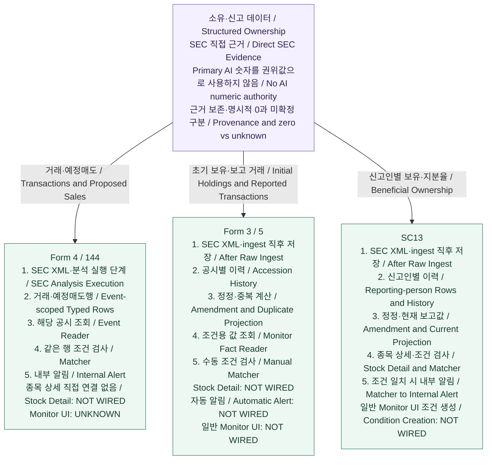

# Ownership Overview — Verified As-Is

> **No inference:** Ownership 비교 단계 4-A와 아래 세 상세 문서만 요약한다. 새 코드·DB 조사나 제품 실행은 하지 않았다. 기준 commit은 `f0d3a92e5eef025e1cdf8200045e2a34aeef7a85`이며, 확인 수준은 **CODE/WIRED + DB STRUCTURE VERIFIED**다. 개념적으로 같은 Ownership이라는 사실을 공통 구현의 증거로 사용하지 않는다.

## 1. 10초 요약

Ownership은 SEC 직접 근거에서 보유·거래 정보를 만드는 구조화 데이터 영역이다. **Form 4/144, Form 3/5, SC13은 서로 다른 저장·reader·consumer 경로**를 가진다. AI가 작성한 투자자용 설명을 구조화 숫자의 권위 source로 사용하지 않는다.

## 2. Ownership 상위 지도

부모 박스는 공통 목적을 나타낸다. 세 화살표는 family 분류이며 공통 runtime 호출을 뜻하지 않는다. 각 branch의 번호는 간략한 처리 흐름이다. 공유 parser·persistence·current reader·Matcher를 가정하지 않으며, branch 사이의 데이터 연결이나 공통 저장 박스로의 합류는 그리지 않는다.

박스 안 한국어는 쉬운 설명, 영어는 개발 용어 대응이다. SC13의 Stock Detail과 Matcher는 별도 소비 경로이며, 내부 Alert는 Matcher 결과에서 생성된다. Stock Detail이 Alert를 생성한다는 뜻이 아니다. 표시한 연결은 코드 수준이며 운영 활성화나 외부 발송 성공을 뜻하지 않는다.

### Current를 읽는 법

- **Form 4/144 current:** 특정 event에 현재 저장된 typed rows.
- **Form 3/5 current:** 저장 filing history 기반의 정정·중복·보유 교정 projection.
- **SC13 current:** 저장 이력과 amendment lineage 기반의 reporting-person 현재 보고값 projection.

어느 것도 **회사 전체 최신 보유량 또는 실시간 잔고**로 읽으면 안 된다. Form 3/5 Monitor Fact Reader는 correction 정보가 있어도 해당 공시의 원래 holdings snapshot을 읽는다.

## 3. 저장과 실행의 핵심 차이

Form 4/144는 SEC 분석 실행 단계에서 **event-scoped 행을 원자적으로 교체**한다. Form 4 거래와 Form 144 예정매도를 구분하며, 별도 amendment event를 current reader가 자동 통합하지 않는다.

Form 3/5와 SC13은 raw ingest 직후 각각의 **accession 기반 insert-or-verify**를 실행한다. 동일 replay는 `replayed`, 내용 충돌은 거부하며 정정 accession은 별도로 보존한다. 두 경로의 lineage 규칙은 서로 다르다. Form 3/5의 확정 중복 거래 제외와 SC13의 현재 보고 position 판정을 같은 기능으로 합치지 않는다.

`raw_items`라는 저장 대상을 공유하고 Form 4/144·SC13 내부 Alert가 `user_alert_deliveries`를 사용하지만, 공통 persistence 함수나 동일 dedupe 계약을 뜻하지 않는다. 상세 저장·계보 조건은 각 상세 문서를 따른다.

## 4. Consumer 비교 — CODE/WIRED

| Family | Stock Detail | Monitor UI | Matcher | Internal Alert |
| --- | --- | --- | --- | --- |
| Form 4/144 | Typed rows 직접 연결 **NOT WIRED** | **UNKNOWN** | Event reader → same-row Matcher **WIRED** | 자동 내부 Alert **WIRED** |
| Form 3/5 | **NOT WIRED** | **NOT WIRED** | 수동 Matcher **WIRED**, 확인된 호출자는 검증 스크립트 | 자동 Alert **NOT WIRED** |
| SC13 | Ownership API → Schedule 13 **WIRED** | 일반 조건 생성 **NOT WIRED** | Current-state → same-row Matcher **WIRED** | 자동 trigger → 내부 Alert **WIRED** |

SC13의 사용자별 Monitor API 존재와 일반 Monitor UI 연결은 별개다. 모든 내부 Monitor Alert는 Primary Score Alert와 구분하며, 외부 delivery는 UNKNOWN이다.

## 5. Primary와의 관계

**Primary Analysis**는 투자자용 설명·점수를 만든다. **Structured Ownership**은 SEC XML 직접값을 사용한다. 각 family 내부에서 원문/parser 일부를 재사용할 수 있지만, 세 family가 공통 parser를 사용한다고 일반화하지 않는다. **`Primary LLM → Ownership 숫자` 관계는 없다.**

값의 권위와 실행 실패 경계도 구분한다. Form 4/144는 분석 실행에 결합돼 있고 조건부 실패 fallback이 존재한다. Form 3/5와 SC13은 raw ingest 직후 저장하므로 Primary LLM 성공을 요구하지 않는다.

## 6. Verification Level

세 상세 감사의 기준 commit은 `f0d3a92e5eef025e1cdf8200045e2a34aeef7a85`다. 확인 수준은 **CODE EXISTS / WIRED + DB STRUCTURE VERIFIED**이며, 당시 shared-local의 각 family 실제 저장 표본은 0건이었다. 이번 문서 작성 중 DB 상태를 다시 조회하지 않았다.

따라서 **STORAGE VERIFIED / PRODUCT PATH VERIFIED / E2E VERIFIED가 아니다.** 문서의 Mermaid 렌더링 검증도 제품 E2E를 대신하지 않는다. 과거 fixture·synthetic test·PASS 기록으로 수준을 승격하지 않는다.

## 7. UNKNOWN / TO AUDIT

- 실제 filing 저장 → reader → consumer 제품 경로 및 E2E
- 실제 amendment·multi-owner·명시적 zero 표본과 불완전한 이력의 영향
- Form 3/5 실제 SEC duplicate positive 사례
- 운영 수집 활성화. Form 3/5는 상세 문서 기준 정기 수집 목록에 없으며 raw ingest hook 존재와 구분
- Form 4/144 Monitor UI 연결
- 외부 Telegram/email delivery

## 8. 상세 문서

- [Form 4/144 Structured Ownership](03-ownership-form4-144.md)
- [Form 3/5 Structured Ownership](03b-ownership-form3-5.md)
- [SC13 Structured Ownership](03c-ownership-sc13.md)
