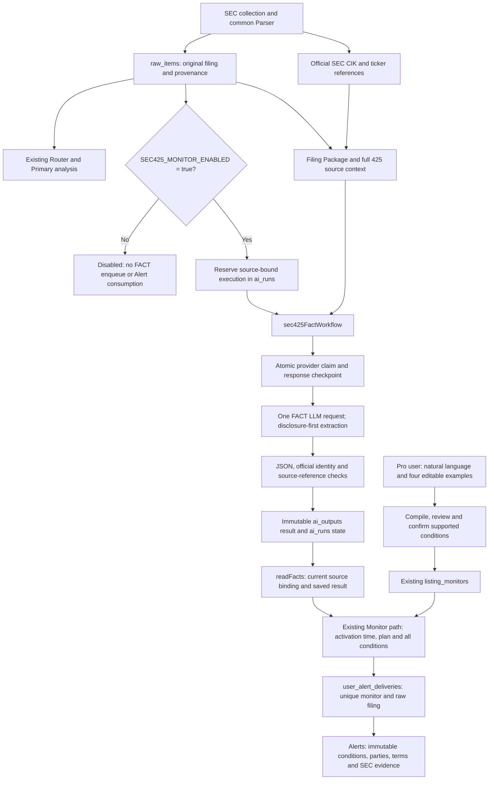

# SEC 425 FACT Monitor — local main integration

Updated: 2026-10-15 KST. Verified product merge: `ca8fb4f77955b712e0543ce24f86e19c818e36c7`.
Full candidate: `2818030adcbb2d06f4442923c98856ab2ed514d6`; previous main: `8a2bb826d38eeca6e0eb071e7017d66e579ba46a`.

**Status: integrated into local main; operating activation remains OFF.** GitHub publication is a code/documentation checkpoint, not deployment, production migration, or release readiness. Earlier experiment reports are historical; use this page for the integrated scope and current limitations.

### CSS build and image-review closeout — 2026-10-15

Local product main `defe494fb178fdb39041836a3f7ef414b9c33724` merges CSS fix `4b02faf3b10d4ddc4ece58c4d6e086decbbb8bf1`. Dashboard global rules moved to a regular stylesheet; local classes remain in the CSS Module. An independent comparison preserved all 173 selector occurrences, declaration values/order and media/keyframe contexts. The only JSX change is the stylesheet import. The related test reads the two actual sheets and retains its layout assertions. No 425, Primary, Monitor, DB or environment implementation changed.

The normal `npm run build` command (`next build`, Turbopack) now **PASSES** on the candidate and on an exact archive of merged main with existing dependencies copied inside the build root. Main's running 3110 and user `next-env.d.ts` were not modified by this isolated build. The first archived-build attempt rejected an external dependency junction; this was a temporary harness layout error, resolved without changing product configuration. The optional `--webpack` build passes the former CSS failure but still fails on an unchanged `node:crypto` import through `corporateActionAdjustment` → `preview` → `DilutionRegistryPreview`; that separate bundler issue was not fixed here.

Candidate dashboard regression: 38 PASS. Existing protected suites retain 938 PASS / 8 skips / 1 unrelated mutation-origin inventory failure. Post-merge focused dashboard/425/S-4/Alerts regression: 89 PASS / 8 existing optional skips; typecheck (including the merged-main build) and diffcheck PASS. Existing main login was reused to inspect Monitor/Alerts at actual CSS widths 1440/900/390, with images, no document overflow and no observed console error. 390px Alerts used viewport sections when full-page capture timed out. Dashboard and portal/detail/filter UI was inspected at those widths; data-filled detail/filters use existing fixture responses in an external harness, not a live market API E2E. Light/dark, scroll, close and filtering were checked. Main `/dashboard-v2` HTML returned 200 and main 390px Monitor/Alerts smoke was repeated after merge. The image-review gap described in the original integration ledger below is therefore closed for this scope.

Receipts: `%TEMP%/sec425-css-final-n8ZgnB/` and the existing UI worktree's `css-build-20261015/` evidence folder. Main remains default OFF; provider/Worker calls, product DB changes, push and deployment in this closeout: zero. The following ledger preserves the original 425 integration checkpoint rather than rewriting its earlier failures as historical PASS results.

## Product scope

- One current announcement per filing: new acquisition proposal, revised acquisition proposal, or signed definitive agreement. Transaction type is separate from announcement type.
- Preserve source-backed parties and roles, consideration, non-binding terms, accession, source URL and evidence locations. FILED BY / SUBJECT COMPANY roles do not establish acquirer / target roles.
- The FACT model first identifies what this disclosure newly announces. Prior agreements, future meetings, shareholder approval or transaction promotion do not become a new agreement FACT merely because the document mentions an agreement.
- `not_applicable` and `uncertain` do not produce matching announcement alerts. Unknown official company/ticker identity is not filled from model strings.
- Existing natural-language Monitor review/save and internal Custom alerts are reused. No new administrator approval system, Registry authority, transaction-price calculation, seven-event state machine or external-delivery system.

## Verified implementation structure

The arrows describe implemented paths. The FACT path operates only when explicitly enabled; they do not imply that it is currently running on main or in production.

Primary is not the FACT source and its Router skip is not a no-event decision. FACT matching uses the raw filing identity and does not require a Primary event. The renderer/validator does not repair the model's announcement classification. Whitespace-equivalent quotations can resolve to exact source coordinates; a missing source block or unsupported company reference cannot be guessed.

| Layer | Source of authority / implementation |
| --- | --- |
| Collection and handoff | `lib/secIngest.ts`, `lib/sources/sec/parser.ts`, `lib/prompts/secFilingAnalysisPackage.ts` |
| Official identities and filing roles | `lib/sources/sec/forms/425/verification.ts`, `lib/sources/sec/sourceTickerSelection.ts` |
| FACT prompt, mechanical evidence checks | `lib/sec425/facts.ts`, `lib/ai/sec425FactInput.ts` |
| Enqueue and workflow | `lib/sec425/starter.ts`, `workflows/sec425-facts.ts` |
| Binding, durable execution, saved result and official reader | `lib/sec425/storage.ts`: `sourceInput`, `processFacts`, `readFacts` |
| Conditions, matching and immutable Alert evidence | `lib/sec425/conditions.ts`, `consumer.ts`, `evidence.ts` |
| Natural-language preview | `app/api/monitors/listing/compile/425-preview/`, existing compiler and `ListingMonitorDraftBuilder.tsx` |
| Existing save/read and Alert UI | Listing Monitor APIs/persistence and `SecondaryMonitorAlertDetails.tsx` |

## Storage, replay and activation

Migration: [`20261014220801_sec425_fact_monitor.sql`](../../supabase/migrations/20261014220801_sec425_fact_monitor.sql).

- Reuse `ai_runs` / `ai_outputs` with purpose/type `sec425_facts`. Store a compact binding to raw source/hash/request fingerprint, provider response checkpoint and final result; do not duplicate the entire SEC document in a new canonical source store.
- `reserve_sec425_facts`, `sec425_transition`, `finish_sec425_facts` are invoker functions, callable by `service_role`, not `anon` or `authenticated`. History/result triggers protect bindings, completed checkpoints and terminal results.
- `sec425_execution_once` / `sec425_output_once` prevent duplicate execution/output. A started request with unknown outcome is not reclaimed into another provider call.
- Workflow step retries and the bounded busy wait are not permission to repeat the LLM request: the persistent provider claim/checkpoint remains authoritative.
- Alert evidence uses `sec425_raw_item_id` and `sec425_match_evidence`. `sec425_alert_once` is unique on `(listing_monitor_id, sec425_raw_item_id)`; existing families' Alert contracts remain in the migration's other branches.
- `SEC425_MONITOR_ENABLED` must equal the string `true`. The flag is absent in main's local environment. Enqueue and consumption return `disabled`; new/updated 425 conditions are gated by activation and Pro entitlement. Read-only compiler preview and existing evidence display are not operating activation.
- UI examples remain visible while OFF. Preview is not authorization to save, match or alert. Do not click Build monitor as a no-cost health check: the existing compiler can make a provider request.

## Verification ledger

Different levels of proof are deliberately separate.

| Verification | Result and limit |
| --- | --- |
| Fresh SEC + fresh FACT provider, isolated database | Diana/Genco: revised proposal, DSX/GNK roles, consideration/non-binding terms, official reader and one internal Alert. Axcelis: prior agreement/current approval distinguished, `not_applicable`, zero agreement Alerts. PASS. |
| Physical requests in that final live run | Two FACT requests total; no Router/Primary/compiler requests, repair or fallback in that run. This is not the total across all earlier experiments. |
| Replay and concurrent processing | No additional provider request or Alert in the retained final live E2E. PASS. |
| Candidate natural-language user journey | Four editable examples; retained real compiler response replay; real login, review/save 201, Free denial 403, other-owner isolation and anonymous disabled input. Fresh compiler semantics were not re-tested in the freeze gate. |
| Review-time test corrections | Two test files only: missing universe mock export and real Gemini serializer inclusion in S-4/F-4's function sandbox. Assertions, fixtures, expected values, skips and timeouts unchanged. Committed in `2818030a`. |
| Actual merged-main regression | 938 PASS, 8 existing conditional skips, 1 existing failure. Monitor/FACT/cover/ticker: 614 PASS + 8 skip; Primary/source/Auth/UI: 197 PASS + 1 fail; historical experiment contracts: 127 PASS. These are selected regression suites, not every repository test. |
| Existing regression failure | `mutationOriginInventory.test.ts` expects cron/authorization/secret text directly in `app/api/cron/source-ingest/cancel/route.ts`. The route delegates to `sourceIngestAuthResponse`. Route, helper and test are unchanged from pre-merge main; the same regex fails on both source versions. No assertion was weakened or removed. |
| Main typecheck / cumulative diff | PASS. Merged Git tree equals the full candidate tree. |
| Production build | Known pre-existing CSS Modules pure-selector failure in `StockRadarDashboardV2.module.css`, reproduced on main and candidate before integration. Kept separate; not fixed or re-run during main integration. No build PASS claim. |
| Main browser/API | Existing authenticated session: `/monitor` and `/alerts` load; four examples and editable input checked; relevant query APIs return 200, anonymous listing/query APIs 401. Actual CSS viewports 390/900/1440 x 900 show no document overflow; console errors 0 in observed paths. Main contains no live 425 test Alerts because it stays OFF. |
| Visual limit | One desktop Alerts image was observed; repeated browser capture timeouts prevented the complete saved viewport screenshot set. Full post-merge image review remains incomplete. DOM checks are not a substitute for that claim. |
| Main default OFF | Actual enqueue and consumer return `disabled` before network access. Integration provider/Worker calls: zero. |

Warnings remain scoped: Diana has one ancillary condition quotation that cannot be bound exactly to its stated source field; its unavailable term is not promoted into supported evidence. Unverified Star Bulk identity is not attached to an arbitrary ticker. Neither warning invalidated the verified core Diana proposal and DSX/GNK links.

## Local integration and publication boundary

- On 2026-10-15, only the named 425 migration was applied to main's verified local PostgreSQL endpoint `127.0.0.1:56722`, after a complete custom-format backup and archive decode check. Ledger: 150 to 151. Existing raw items, AI runs/outputs and checked Monitor/Alert rows were unchanged; new nullable Alert columns are excluded only when comparing the prior column projection.
- Full history-preserving `--no-ff` merge, no conflicts. Existing `next-env.d.ts` user bytes and diff are preserved and excluded from commits. Main review server uses port 3110.
- Local integration receipt: `%TEMP%/sec425-main-integration-GRgM7l/FINAL-REPORT.json`; backup/migration proof and regression logs are alongside it. Candidate live evidence: `%CODEX_HOME%/visualizations/sec425-final-live-e2e-20261015/continue-live/`. These private artifacts, raw documents, credentials and captures are not committed.
- Read-only hosting check for this publication: both Stock Radar Render web services and its delivery cron report automatic deploy OFF; the cron remains suspended. Vercel's repository-filtered project inventory returned no linked Stock Radar project; its existing latest deployment remains `dpl_8x8yCBA6mw67f7pkyQrLR7YtBXqU`. No deploy/settings change was requested or performed.
- User authorized GitHub publication after the above integration result, including its documented limitations. Final local/GitHub SHA equality is verified after push; this document does not invent its own future commit hash.
- Remote DB/migration state, production activation, deployed-code equality and launch readiness remain unverified. No remote migration, cron activation, external delivery or deployment is part of this publication.

## Historical supporting records

- [Final live E2E chronology](../operations/SEC425_FINAL_LIVE_E2E.md) — includes earlier failed/stopped attempts; the final completion section supersedes those interim outcomes.
- [Implementation checkpoints](../operations/SEC425_MONITOR_IMPLEMENTATION.md) — historical candidate-stage checks, not current integration status.
- [Disclosure-first worker E2E](../operations/SEC425_DISCLOSURE_WORKER_E2E.md).
- [Final diagnostics and existing build failure](../operations/SEC425_FINAL_DIAGNOSTICS.md).
- [Production source-of-truth rules](../operations/PRODUCTION_SOURCE_OF_TRUTH.md).
