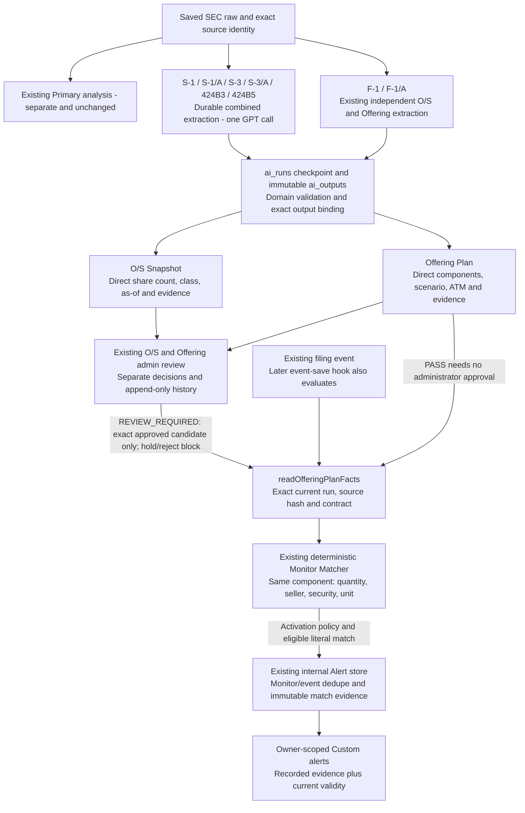

# Offering Plan direct FACT Monitor — local main

## Local main integration — 2026-10-13 KST

**Integrated at `7651dad75da9137458de78efdb345de7ba65195c`**, from candidate `eac0545bddff3f4684cabe49e1225e8fdb89e65e`. Normal no-fast-forward merge, no conflicts; integrated tracked tree equals the candidate. The dated candidate findings below remain history and do not override this checkpoint. This is local product verification, not a production deployment or completion of every SEC family.

- Domestic automatic scope is exactly **S-1, S-1/A, S-3, S-3/A, 424B3, 424B5** (`lib/sec-combined-offering/eligibility.ts`), not every 424B or F-3. One independent GPT extraction produces separate O/S and Offering domain results. F-1/F-1/A retain their independent O/S and Offering paths and share the Offering output-r3 ATM contract. Primary prose, scores, prompts, storage and filing pages are unchanged.
- `raw_items` owns the retained SEC source. Compact bindings refer to the exact source, contract and fingerprint; the worker reconstructs and checks them. `ai_runs` preserves checkpoints and `ai_outputs` preserves immutable responses/domain views. A combined child is a validated projection of its exact parent response, not another model call. No new canonical full-filing copy or numeric correction is introduced.
- `readOfferingPlanFacts` verifies the latest exact invocation, output/source integrity and review selection. **PASS is automatic**; a member's Monitor never waits for routine administrator approval. Only REVIEW_REQUIRED needs the existing exact candidate review. Hold/reject, incomplete latest work and invalid/stale source are blocked; an older PASS is not substituted.
- Current Monitor compares four typed conditions on one component: stated quantity `gte`, seller, security and exact source unit. It does not sum rows, convert ADS, calculate post-O/S or dilution, infer execution from registration, or interpret scenario prose. ATM-linked and over-allotment-linked components are outside this condition. A separately stated warrant-underlying share component may carry its literal exercise condition; that is not actual issuance or an unconditional maximum.
- Result completion/replay and the existing later-event path reach `offeringPlanRunSaved` / `consumeOfferingPlanEvent` and the generic consumer. A persisted event remains required; a raw filing with no event is not a completed Alert path. Activation-date policy and existing Monitor/event uniqueness remain intact. `/alerts` exposes allowlisted recorded evidence and separately reports current validity; later changes do not rewrite the Alert.
- No new projected calculation runs or calculated-value Alerts. `eac0545b` removed the unused calculator and ten calculator-only tests; historical Fact shape/version strings remain in `historicalContract.ts`, with history/access/retirement tests retained. Already-applied historical SQL definitions and historical rows remain; this is application-path retirement, not a claim that legacy SQL functions were revoked.
- Registry remains the separate, timely SEC-backed share-count/capital-structure history and its existing Preview/Apply/readers. Monitor is a consumer. This adapter neither replaces Registry nor automatically applies every extraction to Registry/share-count history.

### Single source architecture diagram

The Mermaid below is the detailed Offering connection's single Markdown source. Architecture Map links here rather than duplicating the graph.

### Verification: distinguish source accuracy, replay and integration smoke

| Check | Evidence and limit |
| --- | --- |
| Retained real source | iBio 424B3 `0001104659-26-012183`: 1,408,481 existing Common Shares; separate 9,653,257 pre-funded warrant underlying shares. Original date 2026-02-09. Full retained source and latest combined response compared; no new extraction claim. |
| Normal automatic positive | A clearly TEST ONLY filing/event envelope reused that real source and response with accession `0000000001-26-913003` and test date 2026-10-14. Existing owner saved a new Monitor through `/monitor`; durable combined completion → persistence → official reader → generic Matcher → internal Alert. No activation override or administrator decision. This is a retained-response connection E2E, not fresh SEC ingestion/model-quality validation. |
| Result and replay | New Monitor `26247a09-1663-4bda-9045-f2f9f606ae3d` received Alert `2dbad9cb-6abd-4829-a2aa-f099499f9744`. One previously saved matching Monitor received its own Alert. Two eligible Monitors, one Alert each; replay added zero facts/results/Alerts. Real provider calls 0. |
| Main regression | 376 PASS / 4 existing optional fixture skips; Combined 25, O/S 37, Offering 45, Alerts 76, filing UI 46, related Monitor 151, additional impacted tests 52 PASS. Suites overlap and must not be summed. Full typecheck, production build and cumulative diff check PASS. |
| Main browser/readback | Merged main code on temporary 3123 against the existing isolated test DB: normal owner/admin login, recorded Alert/current source, real iBio Offering↔O/S navigation; 1440×900, 900×900, exactly 390×900; no horizontal overflow or console errors. Ten HTTP owner/other-owner/anonymous/origin checks PASS. No new Monitor/Alert/admin decision in this smoke; ordinary test authentication writes occurred. |
| Permanent main DB | Existing four Alerts read successfully with the actual official reader; nine Monitors, four Alerts, raw rows, AI runs/outputs and O/S/Offering decision rows retained their pre-migration data hashes. Positive test Alerts were not copied into this DB. |

### Local migration and operations checkpoint

Backup taken before applying **only** these five migrations, in repository order, using the CLI with exact already-applied source files plus these pending files. Existing 136 ledger entries unchanged; five added. No bulk application of other pending migrations or ledger repair.

1. `20261009104931_projected_offering_dilution_v1.sql` — preserved historical contracts/read dependencies.
2. `20261009175018_sec_combined_offering_durable.sql` — combined durable storage and guards.
3. `20261009180530_projected_offering_common_inputs.sql` — preserved historical/common input reader dependencies.
4. `20261012162202_offering_plan_monitor_evidence.sql` — immutable direct match evidence.
5. `20261012173310_offering_plan_stated_component_compat.sql` — explicit current meaning alongside historical validation.

On this workstation, Windows reserved the old 56321/56322 range. The same main data volume was recovered at loopback API **56721** / PostgreSQL **56722**, with existing credentials and DB system identifier preserved. Only local endpoint values in ignored `.env.local` and `.env.development.local` changed; tracked Supabase configuration was not rewritten. The checked temporary CLI workspace records these alternate ports; do not assume repository-default CLI ports reach this recovered DB. Main review server **3110** remains running; temporary main UI server 3123 was stopped. The existing user-owned `next-env.d.ts` bytes and diff are unchanged and excluded from commits.

Private backup/log/screenshot evidence remains outside Git in `%TEMP%/offering-main-integration-20261013-154834`; retained-source/automatic E2E evidence is `%TEMP%/offering-direct-monitor-1f6c-20261013` (`combined-auto-v2-*`). No credentials, raw source bundle, database dump or screenshots are published here. No new GPT/Worker execution, remote DB change, external message or deployment occurred during integration.

## Detailed contract and dated candidate evidence

The contract below remains applicable. Dated candidate verification and migration notes preserve earlier evidence and blockers; their prior “unverified/not merged” status is superseded only for the exact local checks above. No omitted production or extraction-quality check is implied.

## Registry purpose and boundary

Registry continuously maintains each issuer's share counts and capital structure from the latest SEC evidence, rather than remaining on an old quarterly/annual O/S observation. Existing main paths include dilution instruments/snapshots/activity/totals, share-count history, exact class/as-of resolution, stock Dilution reads, and combined Apply of Registry plus verified O/S. Monitor is a consumer of that data. This direct-FACT adapter neither defines the whole Registry nor replaces or necessarily updates every Registry path; adapter unavailability does not imply missing Registry functionality. This work does not delete, reduce or redesign Registry or share-count management.

## Current path and meaning

This adapter follows the existing Proxy/S-8 pattern: the official reader verifies retained source/output identity and review selection, projects typed fields, and the existing generic Monitor compares them. Source prose and freeform `scenario` are evidence for the user; Monitor does not extract, repair, or certify their meaning.

`/monitor` preset → existing editor/review/save → `readOfferingPlanFacts` → existing matcher/consumer → immutable internal Alert → owner-scoped `/alerts` list/detail. Primary outputs, extraction prompts/schemas, O/S authority and Registry are unchanged. No quantity sums, ADS conversions, projected O/S, execution or closing inference.

All four conditions are required exactly once, on the **same component**:

| Key | Operator | Value |
| --- | --- | --- |
| `offering_plan.stated_component_quantity` | `gte` | Direct nonnegative decimal string |
| `offering_plan.seller_type` | `eq` | `issuer` or `selling_shareholders` |
| `offering_plan.security_type` | `eq` | `common_stock`, `ordinary_shares`, `ads` |
| `offering_plan.quantity_unit` | `eq` | Exact stated unit |

Meaning: **the quantity stated in this plan component satisfies the conditions**. This does not establish current unconditional issuance. The stored scenario is displayed verbatim, including conditional exercise or resale context. Rows linked by typed over-allotment/ATM relationships remain out of scope. Blank/not-stated quantities and unsupported seller/security values cannot match and are never zero-filled. Separate rows are neither combined nor reclassified from their labels.

## Integrity and execution

`readOfferingPlanFacts` selects the latest exact raw invocation and designated Offering child, verifies source/output hashes, contracts and evidence refs, then permits PASS or exactly one approved REVIEW_REQUIRED candidate. Newer incomplete work, non-public status, hold/reject/retry or source mismatch blocks fallback. Format/hash validation is **not semantic correctness approval**. A source/FACT meaning discrepancy belongs in extraction/review, not a second regex extractor in Monitor.

Existing triggers evaluate saved facts after independent/combined result completion or replay, committed administrator approval, saved-event creation and the source-ingest step. No provider, extraction worker, separate queue or external notification is started. Hook failure is logged and can be replayed without undoing the saved result.

The existing consumer retains filing-date activation and unique `(listing_monitor_id, alert_event_id)`. A newly created Monitor does not notify on an older filing. Source validity is checked separately from the immutable historical match snapshot.

## Compatibility and cleanup

`offering_plan.component_quantity` is retired through the existing retirement mechanism: owner readback and pause remain available; new creation, editing, reactivation and execution are blocked. No old Monitor is automatically converted and no partial subset executes. The other three scope keys retain their meanings. New behavior requires an explicit new quantity condition.

Evidence keeps the existing `offering_plan_match_v1` envelope and column. The new key is tied exactly to `meaning=stated_plan_component_not_execution`; the legacy key is tied to its saved `stated_current_plan_component_not_execution` meaning. Mixed contracts are rejected. Old Alerts are labeled historical and not overwritten.

Removed: source paragraph/sentence witness regex, literal quantity/label regex construction, and scenario-based semantic selection. Replaced those tests with typed field boundaries, semantic-discrepancy role separation, exact units, row isolation and retirement tests. Kept only the legacy evidence-format predicate needed to read the already applied historical contract. It does not select live components. Earlier projected-history modules and unrelated families remain unchanged.

## Migration

The applied `20261012162202_offering_plan_monitor_evidence.sql` and its validator are unchanged. New `20261012173310_offering_plan_stated_component_compat.sql` adds a new strict validator and expands only the existing evidence CHECK with legacy OR new validation. No table/column, RLS, immutable trigger, lane or unique-key change.

Local only: Auth/API 56461, owned DB 56462, candidate 3121. A new full backup (`typed-before.dump`) was verified before application. The CLI staging directory contained exact source files for the 139 already registered migrations plus only the new pending migration; `migration up --local --include-all` applied that one migration and added one ledger row. All prior ledger rows and both old functions were compared unchanged. Earlier evidence migration was applied as SQL without ledger registration; it was not reapplied or falsely registered here. Shared DB, main3110 and remote systems were untouched.

## Retained real-source comparison

Retained outputs and source hashes were validated without new extraction or SEC retrieval; source passages were read separately.

| Filing | Typed component result |
| --- | --- |
| iBio 0001104659-26-012183 | c1: selling-shareholder resale 1,408,481 Common Shares. c2: separate 9,653,257 pre-funded warrant underlying shares with exercise scenario. Each can satisfy its own literal row condition; no sum or immediate-issuance claim. |
| Shimmick 0001193125-26-237198 | ATM dollar ceiling $4,986,750; component share quantity not stated. No share match; market/O/S numbers not substituted. |
| Silvaco 0001213900-26-054018 | ATM monetary limits and historical sold quantity in source; plan component share quantity not stated. No match or reconstruction from prior sales. |
| PureCycle 0001193125-24-262591 | Separate resale components: 8,528,786 existing common shares, 5,000,000 Series C warrant underlying shares, 1,510,943 RTI warrant underlying shares. Scenarios remain separate. 50,000 preferred shares outside supported security scope. |
| CAVA 0001628280-23-018945 | Blank IPO share quantity; no match. |

Canaan 0001193125-19-276263 retains blank ADS quantity/ratio. Its separate Class B direct post-offering value is never treated as a total or used by this adapter.

## Verification evidence and boundaries

Current verification starts at detached `0034dd8a48dc2e91a0a9113853c837d4478f3c05`. Artifacts are outside the repository at `C:/Users/PC/AppData/Local/Temp/offering-direct-monitor-1f6c-20261013`, with `typed-` prefixes distinguishing this run from prior evidence. The old `historical-e2e.json` and old Alert remain intact and are not proof of current positive behavior.

Current E2E IDs, test totals and responsive results are recorded below. Historical dependency injection, if used, is explicitly separate from normal activation; database timestamps and filing dates are never changed. A historical positive cannot establish normal automatic positive or a new approval-to-Alert positive.

### Current authenticated verification

A new owner Monitor `5b2fe647-d6fa-4ae4-9d63-1b0c9d6f15e4` was created through `/monitor`: quantity >= 1000000, selling shareholders, common stock, exact unit `shares`. The browser confirmed save, reload persistence, pause and resume. The retired prior Monitor remains readable and cannot be edited/reactivated (422); old Alerts retain their original meaning.

The reused local-only event `7f6208ec-9323-4cbc-bdaa-3f022392c953` points to retained real iBio raw `6f141e9f-d774-4577-a999-15d3e3a1950e` and Offering run `3d183855-5e25-5fab-a723-6296a7e0bb71`.

- Normal activation: **0 new Alerts**, because the Monitor was created after the 2026-02-09 filing.
- Explicit historical dependency injection: only an in-memory Monitor clone used `createdAt=2026-02-08T00:00:00.000Z`; the official reader, matcher and real existing writer created new Alert `29da41e3-96f5-4e7b-a5ae-2399d922c0a5` for c1 (1,408,481 shares). Replay created **0** additional Alerts. No DB timestamp or filing date changed.
- Authenticated list/detail displayed the new Alert, verbatim scenario, filing/run and SEC evidence reference; current source/review validity was confirmed. Historical old Alert was displayed separately.
- Actual Canaan reader: available source, zero eligible components (blank ADS quantity), zero Alert. No quantity/dilution zero was synthesized.
- Access checks: **16 PASS** covering owner/non-owner/logout/cross-origin, unauthorized admin decisions, retired condition mutation and historical readback.
- Exact CSS viewports **1440x900, 900x900, 390x900**: condition review/editor and Alert list/detail; no document horizontal overflow. Normal browser console errors/warnings **0**. `typed-browser-results.json` and `typed-*.jpg` preserve evidence. Full-page images also preserve desktop content beyond the side-panel screenshot crop.
- Read-only integrity comparison: **all pre-existing rows across 10 tracked tables unchanged**, including raw/AI outputs, decisions, roles, old Monitors/Alerts and projected historical facts. Only one new Monitor and one new internal Alert were added. No external delivery.

Checks: combined regression **385 PASS / 4 existing optional skips**, O/S **37**, Offering **45**, Alert **76**, filing UI **46**, related Monitor **151**, isolated DB **89** (rolled back). Suites overlap. Typecheck, production build and `git diff --check` passed. Live provider/GPT/O/S Worker/Offering Worker/SEC collection calls: **0**.

At this historical checkpoint, normal automatic positive and fresh administrator-approval-to-positive-Alert browser E2E were **unverified**; they are not claimed by the historical test. Approval/source gates and automatic entry wiring retain their existing regression coverage. Administrator UI/state was not expanded or mutated in this cleanup. Main independent acceptance remains required before merge; no merge/push/deploy was performed.

### 2026-10-13 KST: normal PASS path audit (no product changes)

Purpose: verify the default PASS path without making administrator approval a prerequisite for all members. REVIEW_REQUIRED remains an exception; no approval policy was changed. Starting product HEAD: `be99012823538ffd26743ce4c546fe16262012b3`.

The owned API/DB were confirmed as 56461/56462 (Postgres system identifier `7694629360856297510`). A read-only inventory of all 22 retained Offering runs and the four existing Monitors found **no PASS filing date on/after the current executable condition's creation time** (`2026-10-12T17:41:02.760Z`, 2026-10-13 KST). Real filings and fixtures were distinguished; no timestamps, source fields, policies, users or roles were changed.

- **PASS:** real iBio `0001104659-26-012183`, run `3d183855-5e25-5fab-a723-6296a7e0bb71`, has zero Offering administrator decisions. Its official reader is available with `decisionId=null`/`candidateIndex=null`; the same-row selling-shareholder/common-stock/shares/1,408,481 quantity matches the existing owner's >=1,000,000 condition. Source/output hashes equal the prior retained-source audit.
- **PASS:** the existing local-only PASS fixture `0000000043-26-810000`, run `0ca5b0be-4b90-57aa-ae86-793b98871890`, is also reader-available without any administrator decision. It produced no eligible typed component in this adapter and is not used as a positive result.
- **PASS, normal non-alert:** two manual consumer evaluations of the real iBio result created 0 and 0 new Alerts, both reporting `monitor_activation_not_met` for that Monitor. This is a policy-preserving negative, **not automatic positive E2E**.
- **Existing evidence reused:** authenticated condition creation API/save/reload/pause/resume and the prior explicit historical-test Alert `29da41e3-96f5-4e7b-a5ae-2399d922c0a5` (1 creation, replay 0). This stage created no new Monitor or Alert. The historical activation injection remains identified as a test and was not rerun or reclassified.
- **Current browser readback:** existing owner session (Free, no role/plan change), `/monitor`, `/alerts` and the expanded Offering detail/SEC evidence link were checked. Product screens did not change; the previous 1440/900/390 screenshots and access-control evidence remain applicable. No SEC page was recollected.
- **Unverified:** an actual automatic trigger invocation that creates a new Alert under normal activation. Source wiring is present in result completion/replay, saved-event handling and ingest; this audit did not execute extraction workers or create a new source event to manufacture that proof. Manual consumer invocation is recorded separately.

Only read-only SQL and 43 local GET requests were used for the data audit; no mutation/RPC, Registry/stock-count/ticker/current/Watchlist write, provider, extraction worker or SEC collection was invoked. Scoped iBio source/output identity was compared instead of repeating shared-database-wide hashes. No migration was applied/repaired. Evidence: `pass-stage-inventory.json`, `pass-stage-normal.json`, `pass-stage-boundaries.json` and `pass-stage-*-dom.txt` in the existing outside-Git evidence folder.

**Historical blocker, superseded by the labeled test-envelope E2E above:** no retained material at this checkpoint satisfied the current normal activation timing for a fresh positive. This stage supplies no automatic-positive or merge approval. Documentation-only changes require no product rebuild; `git diff --check` is the relevant new check. Prior product checks remain identified as prior evidence.
